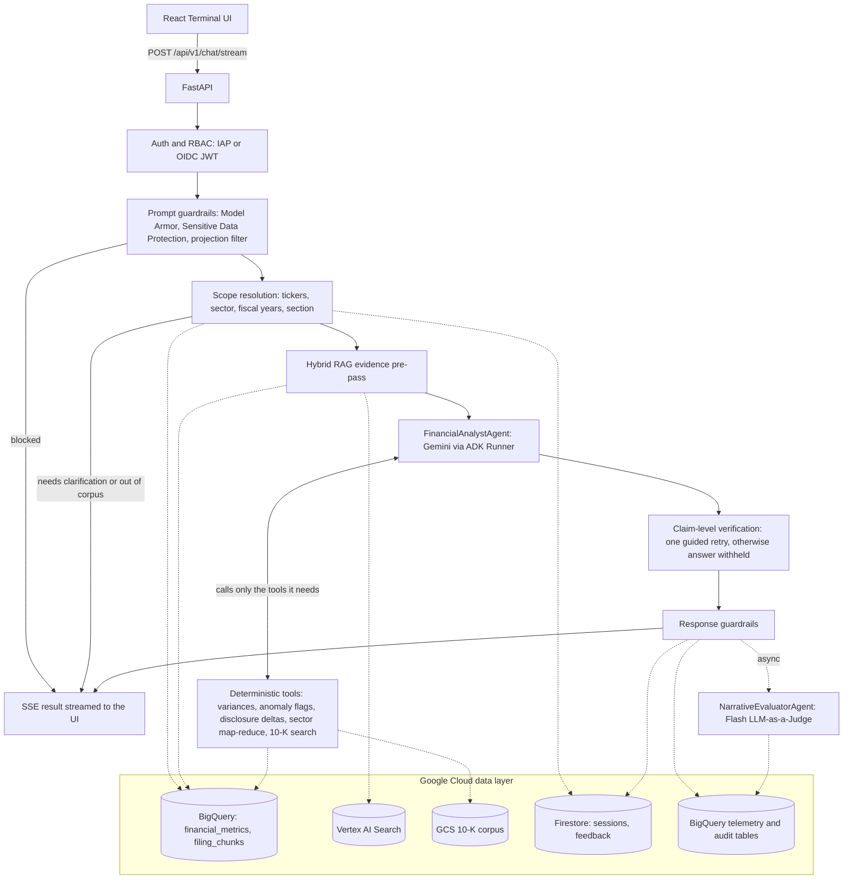

# SEC EDGAR Natural Language Analyst

A conversational analysis workspace for S&P 500 Form 10-K filings. Analysts ask questions in plain English and get cited answers grounded in two sources:

- **Narrative text:** Item 1A (Risk Factors) and Item 7 (MD&A).
- **Financial metrics:** deterministic period-over-period calculations for Revenue, Operating Income, Net Income, and R&D expense, sourced from XBRL.

Answers are written by Gemini through the Google Agent Development Kit (ADK). Every claim is checked against the retrieved passages and computed figures before it reaches the user.

The target architecture and requirements are in [`docs/project_reference.md`](docs/project_reference.md).

---

## How a Query Is Answered



Each turn runs through [`run_conversational_rag_turn`](src/edgar_capstone/agents/chat_engine.py):

1. **Authenticate.** All `/api/v1/*` routes require an identity (IAP assertion, Workspace/Okta OIDC JWT, or a local dev token). Access is controlled by Cloud Identity group RBAC.
2. **Prompt guardrails.** Model Armor, Cloud Sensitive Data Protection, and an SEC projection filter can block the request before any model call.
3. **Resolve scope.** The query is mapped to tickers, GICS sector, fiscal years, and 10-K section. This uses the live S&P 500 catalog in BigQuery and earlier turns from Firestore session memory. Ambiguous or out-of-corpus questions end here with a clarification or coverage notice.
4. **Retrieve evidence.** Hybrid RAG queries BigQuery `VECTOR_SEARCH` over `filing_chunks` and Vertex AI Search in parallel, then balances the hits across the tickers in scope.
5. **Reason.** `FinancialAnalystAgent` runs a structured ReAct loop and returns a structured `AnalystReport`. It calls deterministic tools only when the question needs them. Nothing is pre-computed, so qualitative questions don't get unrequested variance tables.
6. **Verify.** Each finding is checked against the retrieved passages and tool outputs. If every finding fails, one regeneration runs with the rejection reasons. If the retry also fails, the answer is withheld (`answer_verified: false`) instead of being replaced with template text.
7. **Response guardrails, persistence, and telemetry.** The answer is screened again. The turn is saved to Firestore and telemetry is streamed to BigQuery.
8. **Judge (async).** A Gemini Flash LLM-as-a-Judge scores the answer outside the request path. Its score is written to BigQuery when it finishes; until then the turn is recorded as `pending`.

There is no offline mode or local corpus. Every request reads live GCP data and calls live Gemini. Upstream failures return HTTP `503`.

### Agents and Tools

| Component | Role |
| :--- | :--- |
| `FinancialAnalystAgent` | Primary ADK agent (`gemini-3.8-flash`, native thinking). Output is constrained to the `AnalystReport` schema. |
| `NarrativeEvaluatorAgent` | LLM-as-a-Judge (`gemini-3.5-flash`). Scores faithfulness, citation precision, and explanation quality. |
| `calculate_period_variances` / `fetch_financial_metrics` | Deterministic multi-period and YoY variance engine over BigQuery `financial_metrics`. |
| `flag_material_variances` | Rule-based anomaly flags with MD&A explanations and XBRL provenance. |
| `compare_disclosures_across_years` | YoY wording deltas (added, removed, or modified) with citations from both years. |
| `sector_thematic_map_reduce` | Full-sector batched map-reduce for sector-wide thematic questions. Streams progress over SSE. |
| `search_10k_chunks_rag` / `query_cached_10k_context` | Targeted 10-K passage retrieval that returns citable `chunk_id`s. |
| `query_looker_financial_explore` | Aggregated metric queries. Despite the name, it queries BigQuery directly; no Looker instance is deployed. |

Prompts are versioned in [`prompts/`](prompts/registry.yaml). The analyst currently resolves `latest` to `v6`.

---

## Quick Start

### Prerequisites

- Python 3.11+
- Node.js 22+ and `npm`
- `gcloud` with Application Default Credentials (`gcloud auth application-default login`). The principal needs to read BigQuery `sec_edgar`, the SEC corpus bucket, and Vertex AI Search, and to call Vertex AI (embeddings and Gemini).
- Terraform `>= 1.7` (only for infrastructure work)

### Common Commands

| Command | What it does |
| :--- | :--- |
| `make install` | Create `.venv`, install the package with dev extras, and install frontend packages |
| `make dev` | Run FastAPI (`:8000`) and the Vite UI (`:5173`) with hot reload |
| `make start` | Build the UI and serve the single-origin app from FastAPI (`:8000`) |
| `make test` | Secret scan, backend pytest (live GCP, `>= 80%` coverage gate), ESLint, Vitest |
| `make lint` / `make format` | Ruff, Terraform fmt/validate, ESLint (check or auto-fix) |
| `make check` | Every CI gate (`lint` + `test`) |
| `make eval-all` | Golden eval regression gates (see [Evaluation](#evaluation)) |
| `make smoke` | In-process smoke test of `/health` and the UI |
| `make docker-build` / `make docker-smoke` | Build the production image and smoke-test it over HTTP |
| `make help` | List all targets, including corpus publishing (`publish-financials`, `index-vertex-search`, `backfill-rd`) |

Run `make smoke` or `make docker-smoke` with `SMOKE_LIVE_DATA=true` to also check a live BigQuery read.

### Configuration

The Makefile pins the GCP environment (project `iron-radio-514217-q7`, `us-central1`, Gemini on the `global` endpoint), because developer shells often export an unrelated `GCP_PROJECT_ID`. `make test` and `make eval-all` keep telemetry and feedback in memory, so they don't write to production tables.

```bash
CORPUS_PROJECT_ID=<other-project> make dev   # point at another project
```

| Variable | Default | Purpose |
| :--- | :--- | :--- |
| `EDGAR_ANALYST_MODEL` | `gemini-3.8-flash` | Reasoning model for `FinancialAnalystAgent` |
| `EDGAR_FLASH_MODEL` | `gemini-3.5-flash` | Judge and lightweight tasks |
| `EDGAR_GEMINI_LOCATION` | `global` | Vertex AI endpoint for Gemini. BigQuery, GCS, and embeddings use `GOOGLE_CLOUD_LOCATION`. |
| `GEMINI_API_KEY` | unset | Uses the Gemini API instead of Vertex AI when `GOOGLE_GENAI_USE_VERTEXAI` is unset |
| `IAP_STRICT_MODE` | `false` | When `false` (local), the UI can mint an ES256 dev JWT via `POST /api/v1/auth/sso/dev-token`. Always disabled on Cloud Run. |

### Packaging

The runtime install (`pip install .`, used by the `Dockerfile` and `requirements.txt`) is kept lean. Heavy packages are in optional extras:

- `pip install ".[ingest]"` adds the offline dataset and vector-DB build tools (`edgartools`, `pandas`, `google-cloud-storage`).
- `pip install ".[dev]"` adds test and lint tooling; `make install` uses this.

The container image holds only the runtime package, the built UI, and `prompts/`. No corpus data is included.

---

## API

Routers are in [`src/edgar_capstone/api/routers/`](src/edgar_capstone/api/routers/). All `/api/v1/*` routes require authentication except SSO discovery, exchange, and dev-token.

| Route | Purpose |
| :--- | :--- |
| `GET /health` | Readiness, plus status of the active agents, data backends, session memory, and observability |
| `POST /api/v1/chat/stream` | Main chat endpoint (SSE). Emits `connected`, `progress`, 15 s heartbeats, then `result` or `error`. |
| `POST /api/v1/chat` | Same pipeline as a single JSON response |
| `GET /api/v1/companies` | S&P 500 catalog and available fiscal years |
| `GET /api/v1/section` | Full Item 1A / Item 7 Markdown from GCS for the source viewer |
| `GET` · `DELETE /api/v1/sessions[/{id}]` | List or delete the caller's conversation sessions |
| `POST` · `GET /api/v1/feedback` | Submit or list analyst ratings and comments |
| `GET /api/v1/telemetry/sessions` | Session, tool-usage, and telemetry summaries (`audit:read`) |
| `GET /api/v1/auth/config` | Public SSO/IAP discovery and RBAC metadata |
| `POST /api/v1/auth/sso/exchange` · `/sso/dev-token` | Exchange an OIDC token, or mint a local dev token |
| `GET /api/v1/auth/me` · `POST /api/v1/auth/logout` | Current principal, or sign out |
| `GET /api/v1/auth/audit` | Authentication and filing-access audit events (`audit:read`) |
| `GET /api/v1/admin/rbac/policies` | RBAC and per-agent identity inspection (`rbac:admin`) |
| `GET /api/v1/secrets/status` | Secret Manager bindings with values redacted (`secrets:inspect`) |
| `GET /*` | Serves the built React app |

---

## Observability

Each request is one OpenTelemetry trace exported to **Cloud Trace**. Logs are structured JSON with the same trace ID and go to **Cloud Logging**. Every response includes `X-Trace-Id` and `Server-Timing` headers.

On Cloud Run this is all enabled automatically. Locally, spans stay in-process unless you choose an exporter:

```bash
EDGAR_TRACE_EXPORTER=console EDGAR_LOG_FORMAT=json make backend   # print spans and JSON logs
EDGAR_TRACE_EXPORTER=gcp make backend                             # send spans to Cloud Trace
```

Monitoring is done entirely in the Cloud Console:

- **Dashboards:** two Cloud Monitoring dashboards, one for vector DB health and one for LLM telemetry, cost, sessions, and security.
- **Metrics:** log-based metrics under `sec_edgar/*`.
- **Alerts:** p95 latency, 5xx errors, and auth denials or guardrail blocks.
- **BigQuery views:** queried from BigQuery Studio.

See [`docs/observability.md`](docs/observability.md) for configuration variables, metric names, and how to correlate traces with logs and BigQuery rows.

---

## Evaluation

`make eval-all` runs the 63-item golden dataset ([`evals/golden_dataset.jsonl`](evals/golden_dataset.jsonl)) through the live chat pipeline. It exits non-zero if any gate in [`evals/thresholds.yaml`](evals/thresholds.yaml) regresses. The gates cover:

- Numeric agreement
- Citation coverage and grounding recall
- Routing and tool selection
- Judge scores
- Safety
- p95 TTFT

```bash
make eval-all                       # report written to build/evals/
EVAL_WRITE_BQ=true make eval-all    # also stream results to BigQuery sec_edgar.eval_results
make load-golden-dataset            # sync the dataset to BigQuery sec_edgar.golden_eval_set
make refresh-golden-expectations    # recompute expected variances from the engine (review the diff)
```

See [`evals/README.md`](evals/README.md) for the record schema and gate definitions.

---

## Deployment and Access

- **CI/CD:** [`.github/workflows/deploy.yml`](.github/workflows/deploy.yml) uses keyless Workload Identity Federation. It runs lint, tests, and a container smoke test, then `eval-all` on `main`, then deploys to Cloud Run. [`cloudbuild.yaml`](cloudbuild.yaml) defines an equivalent Cloud Build pipeline.
- **Infrastructure:** everything is provisioned by Terraform; see [`terraform/README.md`](terraform/README.md).
- **Access:** IAP fronts the Cloud Run service, so the app is never anonymous. To share it:
  1. Add groups or domains to `iap_authorized_principals` in [`terraform/variables.tf`](terraform/variables.tf) or a tfvars file. Individual `user:` bindings are rejected.
     ```hcl
     iap_authorized_principals = [
       "domain:jackbetcher.altostrat.com",
       "group:sec-edgar-analysts@example.com",
     ]
     iap_default_app_role = "analyst"   # or "viewer"; "" admits nobody without an RBAC group
     ```
  2. Run `terraform -chdir=terraform apply`.
  3. Share the URL from `terraform -chdir=terraform output -raw app_url`.

  To revoke access, remove the principal and apply again.

---

## Repository Layout

```text
├── src/edgar_capstone/
│   ├── server.py            # FastAPI app factory and lifespan hooks
│   ├── api/                 # Routers, request schemas, auth dependencies
│   ├── agents/              # ADK agents, chat pipeline, ReAct loop, verification, deterministic tools
│   │   └── adapters/        # BigQuery, Vertex AI Search, and GCS tool adapters
│   ├── security/            # IAP/OIDC auth, RBAC, per-agent identities, Secret Manager, Model Armor
│   ├── observability/       # OpenTelemetry tracing, structured logging, request middleware
│   ├── telemetry.py         # BigQuery telemetry/audit sinks, Firestore session and feedback stores
│   ├── gcp/                 # Lightweight GCP REST clients (BigQuery, Firestore, Discovery Engine)
│   ├── common/              # Shared helpers: env parsing, domain constants, formatting, caching
│   ├── dataset/             # Offline 10-K XBRL and Markdown extraction pipeline
│   ├── vector_db/           # 10-K chunker, Vertex AI embedder, chunk-health monitor
│   └── evals/               # Golden eval scorers and runner
├── frontend/                # React 19 + TypeScript + Tailwind split-pane UI (see frontend/README.md)
├── prompts/                 # Versioned agent prompts and registry
├── evals/                   # Golden dataset and regression thresholds
├── scripts/                 # CLIs: dataset/vector DB build, corpus publishing, evals, smoke test
├── terraform/               # GCP infrastructure as code
├── tests/                   # pytest suite (live GCP + Gemini)
└── docs/                    # Reference spec and observability guide
```

---

## Known Gaps

Open items against [`docs/project_reference.md`](docs/project_reference.md) (§ = spec section).

| Area | Spec | Status | Next step |
| :--- | :--- | :--- | :--- |
| Raw model p95 TTFT `<= 3,000 ms` | §5 · B1 | Open | Warm TTFT is about 1.9 s, but tail latency on the unprovisioned `global` endpoint still exceeds 3 s. Possible fixes: Provisioned Throughput, regional models, or a smaller prefill. In CI, this gate only produces a warning; all other gates block deploys. |
| End-to-end observability check | §5, §11 | In progress | On the deployed service, confirm that one chat request produces a single trace linked across Cloud Trace, Cloud Logging, BigQuery `trace_id`, and Firestore sessions. |
| Cloud Build triggers | §9 | Deferred | Authorize the Cloud Build GitHub App, store a GitHub PAT in Secret Manager, and apply with `enable_cloudbuild_trigger = true`. GitHub Actions handles deploys until then. |
| VPC Service Controls | §9 | Blocked | Needs an org-delegated Access Context Manager policy. The perimeter is defined in `terraform/vpc_service_controls.tf` but disabled. |
