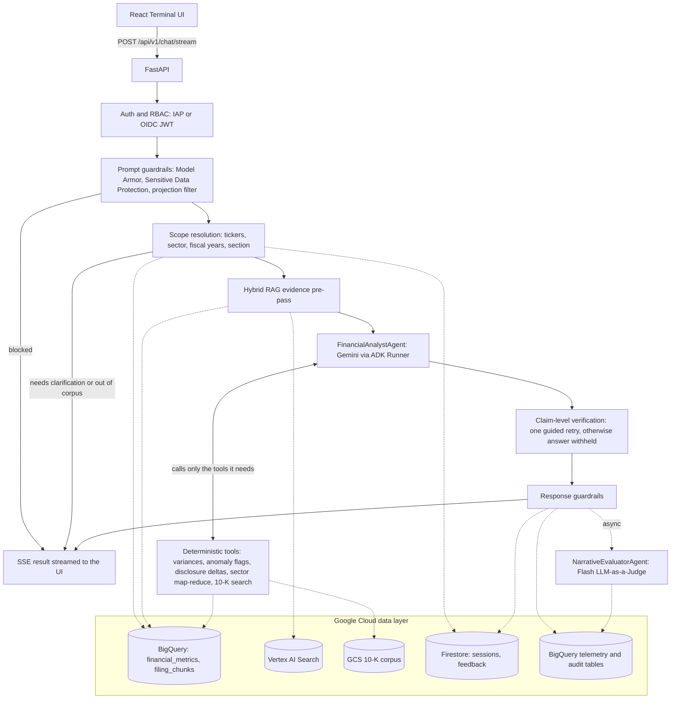

# SEC EDGAR Natural Language Analyst

A conversational analysis workspace for S&P 500 Form 10-K filings. Analysts ask questions in plain English and get cited answers grounded in two sources:

- **Narrative text:** Item 1A (Risk Factors) and Item 7 (MD&A).
- **Financial metrics:** deterministic period-over-period calculations for Revenue, Operating Income, Net Income, and R&D expense, sourced from XBRL.

Answers are written by Gemini through the Google Agent Development Kit (ADK). Every claim is checked against the retrieved passages and computed figures before it reaches the user.

---

## How a Query Is Answered



Each turn runs through [`run_conversational_rag_turn`](src/edgar_capstone/agents/orchestration/chat_engine.py):

1. **Authenticate.** All `/api/v1/*` routes require an identity (IAP assertion, Workspace/Okta OIDC JWT, or a local dev token). Access is controlled by Cloud Identity group RBAC.
2. **Prompt guardrails.** Model Armor, Cloud Sensitive Data Protection, and an SEC projection filter can block the request before any model call.
3. **Resolve scope.** [`scope_validation.py`](src/edgar_capstone/agents/orchestration/scope_validation.py) maps the query to tickers, GICS sector, fiscal years, and 10-K section using the live S&P 500 catalog in BigQuery and prior turns from Firestore session memory. Ambiguous or out-of-corpus questions end here with a clarification or coverage notice.
4. **Retrieve evidence.** [`hybrid_rag.py`](src/edgar_capstone/agents/tools/hybrid_rag.py) queries BigQuery `VECTOR_SEARCH` over `filing_chunks` and Vertex AI Search in parallel (with per-company-year coverage slices), then balances hits across the tickers in scope.
5. **Reason.** [`react_loop.py`](src/edgar_capstone/agents/orchestration/react_loop.py) runs `FinancialAnalystAgent` via the ADK streaming runner ([`live_runtime.py`](src/edgar_capstone/agents/runtime/live_runtime.py)) and returns constrained `AnalystReport` JSON. The agent calls deterministic tools on demand based on the query.
6. **Verify.** [`structured_report.py`](src/edgar_capstone/agents/evaluation/structured_report.py) checks every finding against the retrieved passages and hydrated tool outputs before rendering Markdown. If every finding fails, one guided regeneration runs with the rejection reasons; if that also fails, the answer is withheld (`answer_verified: false`).
7. **Response guardrails, persistence, and telemetry.** The answer is screened again, intent is finalized ([`intent.py`](src/edgar_capstone/agents/orchestration/intent.py)), the turn is saved to Firestore, and telemetry is streamed to BigQuery.
8. **Judge (async).** [`judge.py`](src/edgar_capstone/agents/evaluation/judge.py) scores the answer off the request path with a Gemini Flash LLM-as-a-Judge. Until it finishes, the turn is recorded as `pending`; on completion the real grade and score are written to BigQuery.

Every request reads live GCP data and calls live Gemini; upstream failures return HTTP `503`.

### Agents and Tools

| Component | Module | Role |
| :--- | :--- | :--- |
| `FinancialAnalystAgent` | [`runtime/factories.py`](src/edgar_capstone/agents/runtime/factories.py) | Primary ADK agent (`gemini-3.8-flash`, native thinking). Output is constrained to the `AnalystReport` schema. |
| `NarrativeEvaluatorAgent` | [`evaluation/judge.py`](src/edgar_capstone/agents/evaluation/judge.py) | LLM-as-a-Judge (`gemini-3.8-flash`, `ThinkingLevel.LOW`). Scores faithfulness, citation precision, and explanation quality. |
| `SectorMapSummarizerAgent` | [`tools/sector_map_reduce.py`](src/edgar_capstone/agents/tools/sector_map_reduce.py) | Parallel batch summarizer (`gemini-3.5-flash-lite`) for the map phase of sector-wide thematic reviews. |
| `calculate_period_variances` · `fetch_financial_metrics` | [`tools/sec_tools.py`](src/edgar_capstone/agents/tools/sec_tools.py), [`tools/variance_engine.py`](src/edgar_capstone/agents/tools/variance_engine.py) | Deterministic multi-period and YoY variance engine over BigQuery `financial_metrics`. |
| `flag_material_variances` | [`tools/material_variances.py`](src/edgar_capstone/agents/tools/material_variances.py) | Rule-based XBRL anomaly flags paired with MD&A explanations and filing provenance. |
| `compare_disclosures_across_years` | [`tools/disclosure_deltas.py`](src/edgar_capstone/agents/tools/disclosure_deltas.py) | Deterministic YoY wording deltas (added, removed, modified) using word-trigram alignment with citations from both years. |
| `sector_thematic_map_reduce` | [`tools/sector_tool.py`](src/edgar_capstone/agents/tools/sector_tool.py), [`tools/sector_map_reduce.py`](src/edgar_capstone/agents/tools/sector_map_reduce.py) | Full-sector batched map-reduce over all issuers in a GICS sector. Streams progress over SSE. |
| `search_10k_chunks_rag` · `query_cached_10k_context` | [`tools/sec_tools.py`](src/edgar_capstone/agents/tools/sec_tools.py), [`tools/hybrid_rag.py`](src/edgar_capstone/agents/tools/hybrid_rag.py) | Targeted 10-K passage retrieval returning citable `chunk_id`s. |
| `query_analytics_view` | [`tools/sec_tools.py`](src/edgar_capstone/agents/tools/sec_tools.py) | Aggregated BigQuery analytics views (`sector_benchmarks`, `peer_comparison`, `yoy_variances`, `chunk_health`) and telemetry/audit views. |

Prompts are versioned in [`prompts/`](prompts/registry.yaml) and loaded through [`prompts/store.py`](src/edgar_capstone/agents/prompts/store.py) (supporting local, GCS, and Vertex AI backends). The analyst resolves `latest` to `v7`.

### Agents Package Architecture

[`src/edgar_capstone/agents/`](src/edgar_capstone/agents/__init__.py) is split into seven subpackages layered from zero-dependency foundations up to orchestration:

```text
core ──▶ adapters, prompts ──▶ tools ──▶ runtime, evaluation ──▶ orchestration
```

- **`core/`** — Shared Pydantic schemas (`schemas.py`), retry/exception wrappers and OTel tool spans (`resilience.py`), and inline citation helpers (`citations.py`). No dependencies on other `agents` subpackages.
- **`adapters/`** — Live GCP REST clients and thread-safe adapter registry (`bigquery.py`, `vertex_search.py`, `gcs.py`, `registry.py`).
- **`prompts/`** — Versioned prompt loading (`store.py`) and payload compaction / prompt builders (`builders.py`).
- **`tools/`** — ADK `FunctionTool` wrappers, deterministic analytical engines, and turn-scoped tool plumbing (`runtime.py`).
- **`runtime/`** — ADK `Runner` and persistent SSE event loop (`live_runtime.py`), agent factories (`factories.py`), lifecycle callbacks for Model Armor/identity/budgets/telemetry (`callbacks.py`), and model routing, latency tracking, and session memory (`context_memory.py`).
- **`evaluation/`** — Claim-level `AnalystReport` verification and deterministic Markdown rendering (`structured_report.py`), plus the Flash LLM-as-a-Judge (`judge.py`).
- **`orchestration/`** — Conversational turn entry point and S&P 500 catalog cache (`chat_engine.py`), ReAct loop and background judge pool (`react_loop.py`), scope/coverage validation (`scope_validation.py`), and non-lexical intent resolution (`intent.py`).

Two conventions are worth knowing before editing `agents/`:

- **Turn-scoped tool state (`tools/runtime.py`):** Deterministic tools return compact JSON digests to Gemini to keep prompt prefill small, while writing their full payloads (XBRL provenance, flags, deltas, citations) into ADK `session_state`. `turn_scoped_state_seed()` resets those keys each turn so persistent chat sessions don't leak prior outputs, and `hydrate_tool_outputs()` reads them back before claim verification and UI rendering. Non-serializable per-turn handles (SSE progress callback, cached catalog profiles) travel via `tool_turn_context` (`contextvars`).
- **Cold-start imports (`__init__.py`):** `agents/__init__.py` contains no eager imports (and subpackages such as `tools/` and `evaluation/` use PEP 562 `__getattr__` lazy exports), keeping `google.adk`, `google.genai`, and ingest SDKs off the cold-start import path (enforced by `test_lazy_imports_avoid_heavy_sdks_on_cold_start`). Import symbols directly from their canonical subpackage modules.

### Storage Architecture

Data is split across Google Cloud storage and retrieval services by workload pattern:

| Service | Workload pattern | What it stores | Role |
| :--- | :--- | :--- | :--- |
| **BigQuery** | Analytical scans, vector search, append-only logs | Structured XBRL `financial_metrics`, 768-d embedded `filing_chunks` (`VECTOR_SEARCH`), and streaming telemetry, audit, and eval tables | Serverless SQL and vector analytics at S&P 500 scale |
| **Vertex AI Search** | Managed hybrid lexical + semantic retrieval | Indexed 10-K filings with auto query expansion, spell correction, and extractive segments | Pairs lexical recall and extractive snippets with BigQuery dense vector search in parallel for stronger grounding |
| **Cloud Storage (GCS)** | Immutable large text objects | Full Item 1A (Risk Factors) and Item 7 (MD&A) Markdown sections | Low-cost blob storage for serving full filing sections to the source viewer and cached section reads |
| **Cloud Firestore (Native)** | Low-latency mutable JSON CRUD and per-user state | `analyst_sessions` (multi-turn conversation memory) and `analyst_feedback` (thumbs-up/down ratings and comments) | Fast point `GET`/`PATCH`/`DELETE` and `:runQuery`; serverless scale-to-zero across stateless Cloud Run instances; schemaless nested JSON; SHA-256 `(user_id, session_id)` isolation with `OPTIMISTIC` concurrency via a lightweight REST v1 (`httpx`) client ([`telemetry.py`](src/edgar_capstone/telemetry.py)) |

---

## Quick Start

### Prerequisites

- Python 3.11+
- Node.js 22+ and `npm`
- `gcloud` with Application Default Credentials (`gcloud auth application-default login`). The principal needs to read BigQuery `sec_edgar`, the SEC corpus bucket, and Vertex AI Search, and to call Vertex AI (embeddings and Gemini).
- Terraform `>= 1.7` (only for infrastructure work)

### Common Commands

| Command | What it does |
| :--- | :--- |
| `make install` | Create `.venv`, install the package with dev extras, and install frontend packages |
| `make dev` | Run FastAPI (`:8000`) and the Vite UI (`:5173`) with hot reload |
| `make start` | Build the UI and serve the single-origin app from FastAPI (`:8000`) |
| `make test` | Secret scan, backend pytest (live GCP, `>= 80%` coverage gate), ESLint, Vitest |
| `make lint` / `make format` | Ruff, Terraform fmt/validate, ESLint (check or auto-fix) |
| `make check` | Every CI gate (`lint` + `test`) |
| `make eval-all` | Golden eval regression gates (see [Evaluation](#evaluation)) |
| `make smoke` | In-process smoke test of `/health` and the UI |
| `make docker-build` / `make docker-smoke` | Build the production image and smoke-test it over HTTP |
| `make help` | List all targets, including corpus publishing (`publish-financials`, `index-vertex-search`, `backfill-rd`) |

Run `make smoke` or `make docker-smoke` with `SMOKE_LIVE_DATA=true` to also check a live BigQuery read. For fast local iteration without GCP credentials, run `.venv/bin/pytest -m "not live"` (unit and mocked-transport integration tests; `@pytest.mark.live` tests hit live GCP and Gemini).

### Configuration

The Makefile pins the GCP environment (project `iron-radio-514217-q7`, `us-central1`, Gemini on the `global` endpoint), because developer shells often export an unrelated `GCP_PROJECT_ID`. `make test` and `make eval-all` keep telemetry and feedback in memory, so they don't write to production tables.

```bash
CORPUS_PROJECT_ID=<other-project> make dev   # point at another project
```

| Variable | Default | Purpose |
| :--- | :--- | :--- |
| `EDGAR_ANALYST_MODEL` | `gemini-3.8-flash` | Reasoning model for `FinancialAnalystAgent` |
| `EDGAR_FLASH_MODEL` | `gemini-3.8-flash` | LLM-as-a-Judge (`NarrativeEvaluatorAgent`, `ThinkingLevel.LOW`) |
| `EDGAR_LITE_MODEL` | `gemini-3.5-flash-lite` | Sector map-reduce (`SectorMapSummarizerAgent`) and event compaction (`LlmEventSummarizer`) |
| `EDGAR_GEMINI_LOCATION` | `global` | Vertex AI endpoint for Gemini. BigQuery, GCS, and embeddings use `GOOGLE_CLOUD_LOCATION`. |
| `GEMINI_API_KEY` | unset | Uses the Gemini API instead of Vertex AI when `GOOGLE_GENAI_USE_VERTEXAI` is unset |
| `IAP_STRICT_MODE` | `false` | When `false` (local), the UI can mint an ES256 dev JWT via `POST /api/v1/auth/sso/dev-token`. Always disabled on Cloud Run. |

### Packaging

The runtime install (`pip install .`, used by the `Dockerfile` and `requirements.txt`) is kept lean. Heavy packages are in optional extras:

- `pip install ".[ingest]"` adds the offline dataset and vector-DB build tools (`edgartools`, `pandas`, `google-cloud-storage`).
- `pip install ".[dev]"` adds test and lint tooling; `make install` uses this.

The container image packages the runtime library, the built UI, and `prompts/`; corpus data is read from GCP at runtime.

---

## API

Routers are in [`src/edgar_capstone/api/routers/`](src/edgar_capstone/api/routers/). All `/api/v1/*` routes require authentication except SSO discovery, exchange, and dev-token.

| Route | Purpose |
| :--- | :--- |
| `GET /health` | Readiness, plus status of the active agents, data backends, session memory, and observability |
| `POST /api/v1/chat/stream` | Main chat endpoint (SSE). Emits `connected`, `progress`, 15 s heartbeats, then `result` or `error`. |
| `POST /api/v1/chat` | Same pipeline as a single JSON response |
| `GET /api/v1/companies` | S&P 500 catalog and available fiscal years |
| `GET /api/v1/section` | Full Item 1A / Item 7 Markdown from GCS for the source viewer |
| `GET` · `DELETE /api/v1/sessions[/{id}]` | List or delete the caller's conversation sessions |
| `POST` · `GET /api/v1/feedback` | Submit or list analyst ratings and comments |
| `GET /api/v1/telemetry/sessions` | Session, tool-usage, and telemetry summaries (`audit:read`) |
| `GET /api/v1/auth/config` | Public SSO/IAP discovery and RBAC metadata |
| `POST /api/v1/auth/sso/exchange` · `/sso/dev-token` | Exchange an OIDC token, or mint a local dev token |
| `GET /api/v1/auth/me` · `POST /api/v1/auth/logout` | Current principal, or sign out |
| `GET /api/v1/auth/audit` | Authentication and filing-access audit events (`audit:read`) |
| `GET /api/v1/admin/rbac/policies` | RBAC and per-agent identity inspection (`rbac:admin`) |
| `GET /api/v1/secrets/status` | Secret Manager bindings with values redacted (`secrets:inspect`) |
| `GET /*` | Serves the built React app |

---

## Observability

Each request is one OpenTelemetry trace exported to **Cloud Trace**. Logs are structured JSON with the same trace ID and go to **Cloud Logging**. Every response includes `X-Trace-Id` and `Server-Timing` headers.

On Cloud Run this is all enabled automatically. Locally, spans stay in-process unless you choose an exporter:

```bash
EDGAR_TRACE_EXPORTER=console EDGAR_LOG_FORMAT=json make backend   # print spans and JSON logs
EDGAR_TRACE_EXPORTER=gcp make backend                             # send spans to Cloud Trace
```

Monitoring is done entirely in the Cloud Console:

- **Dashboards:** two Cloud Monitoring dashboards, one for vector DB health and one for LLM telemetry, cost, sessions, and security.
- **Metrics:** log-based metrics under `sec_edgar/*`.
- **Alerts:** p95 latency, 5xx errors, and auth denials or guardrail blocks.
- **BigQuery views:** queried from BigQuery Studio.

See [`docs/observability.md`](docs/observability.md) for configuration variables, metric names, and how to correlate traces with logs and BigQuery rows.

---

## Evaluation

`make eval-all` runs the 30-item golden dataset ([`evals/golden_dataset.jsonl`](evals/golden_dataset.jsonl)) through the live chat pipeline. It exits non-zero if any gate in [`evals/thresholds.yaml`](evals/thresholds.yaml) regresses. The gates cover:

- Numeric agreement
- Citation coverage and grounding recall
- Routing and tool selection
- Judge scores
- Safety
- p95 TTFT

```bash
make eval-all                       # report written to build/evals/
EVAL_WRITE_BQ=true make eval-all    # also stream results to BigQuery sec_edgar.eval_results
make load-golden-dataset            # sync the dataset to BigQuery sec_edgar.golden_eval_set
make refresh-golden-expectations    # recompute expected variances from the engine (review the diff)
```

See [`evals/README.md`](evals/README.md) for the record schema and gate definitions.

---

## Deployment and Access

- **CI/CD:** [`.github/workflows/deploy.yml`](.github/workflows/deploy.yml) uses keyless Workload Identity Federation. It runs lint, tests, and a container smoke test, an optional `eval-all` stage on `main` (defaults to `skip`; set `EVAL_GATE_MODE` or `eval_mode` to `advisory` or `blocking` to enable), then deploys to Cloud Run. [`cloudbuild.yaml`](cloudbuild.yaml) defines an equivalent Cloud Build pipeline (`_EVAL_GATE_MODE`, default `skip`).
- **Infrastructure:** everything is provisioned by Terraform; see [`terraform/README.md`](terraform/README.md).
- **Access:** IAP fronts the Cloud Run service, so the app is never anonymous. To share it:
  1. Add groups or domains to `iap_authorized_principals` in [`terraform/variables.tf`](terraform/variables.tf) or a tfvars file. Individual `user:` bindings are rejected.
     ```hcl
     iap_authorized_principals = [
       "domain:jackbetcher.altostrat.com",
       "group:sec-edgar-analysts@example.com",
     ]
     iap_default_app_role = "analyst"   # or "viewer"; "" admits nobody without an RBAC group
     ```
  2. Run `terraform -chdir=terraform apply`.
  3. Share the URL from `terraform -chdir=terraform output -raw app_url`.

  To revoke access, remove the principal and apply again.

---

## Repository Layout

```text
├── src/edgar_capstone/
│   ├── server.py            # FastAPI app factory and lifespan hooks
│   ├── api/                 # Routers, request schemas, auth dependencies
│   ├── agents/              # ADK agents, chat pipeline, ReAct loop, verification, deterministic tools
│   │   ├── core/            # Shared Pydantic schemas, retry/telemetry resilience, citation helpers
│   │   ├── adapters/        # BigQuery, Vertex AI Search, and GCS tool adapters
│   │   ├── prompts/         # Versioned prompt store (local/GCS/Vertex) and prompt builders
│   │   ├── tools/           # ADK tools, turn-scoped runtime, variance/delta/RAG/sector engines
│   │   ├── runtime/         # ADK Runner/streaming, agent factories, callbacks, context/memory
│   │   ├── evaluation/      # Structured report claim verification/rendering and Flash judge
│   │   └── orchestration/   # Conversational RAG chat engine, intent, scope validation, ReAct loop
│   ├── security/            # IAP/OIDC auth, RBAC, per-agent identities, Secret Manager, Model Armor
│   ├── observability/       # OpenTelemetry tracing, structured logging, request middleware
│   ├── telemetry.py         # BigQuery telemetry/audit sinks, Firestore session and feedback stores
│   ├── gcp/                 # Lightweight GCP REST clients (BigQuery, Firestore, Discovery Engine)
│   ├── common/              # Shared helpers: env parsing, domain constants, formatting, caching
│   ├── dataset/             # Offline 10-K XBRL and Markdown extraction pipeline
│   ├── vector_db/           # 10-K chunker, Vertex AI embedder, chunk-health monitor
│   └── evals/               # Golden eval scorers and runner
├── frontend/                # React 19 + TypeScript + Tailwind split-pane UI (see frontend/README.md)
├── prompts/                 # Versioned agent prompts and registry
├── evals/                   # Golden dataset and regression thresholds
├── scripts/                 # CLIs: dataset/vector DB build, corpus publishing, evals, smoke test
├── terraform/               # GCP infrastructure as code
├── tests/                   # pytest suite (offline unit/integration + `@pytest.mark.live` GCP/Gemini tests)
└── docs/                    # Observability guide
```
