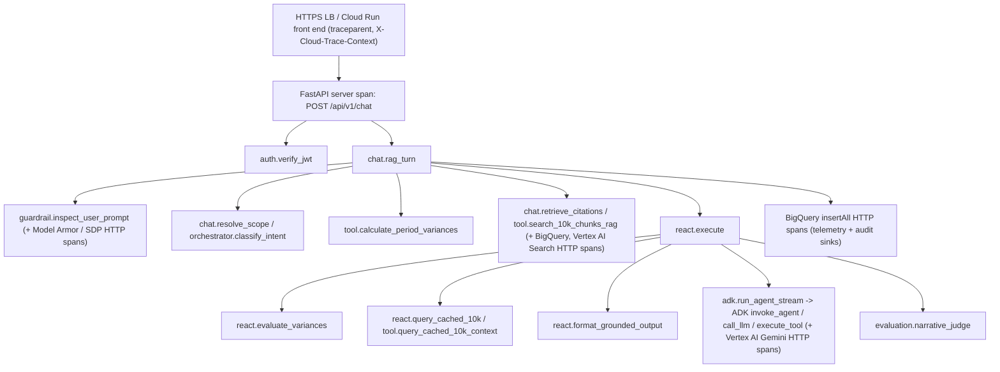

# Observability: End-to-End Latency Tracing & Structured Logs

The FastAPI service exports **OpenTelemetry spans to Cloud Trace** and writes **structured JSON logs carrying trace IDs** to stdout. Cloud Run ingests those logs into **Cloud Logging**. A single `/api/v1/chat` request produces one trace covering the load balancer, FastAPI, guardrails, ReAct steps, tools, ADK model calls, and outbound GCP REST calls. That request's log lines appear grouped under the trace, and its BigQuery telemetry rows carry the same `trace_id`.

Code lives in [`src/edgar_capstone/observability/`](../src/edgar_capstone/observability):

| Module | Responsibility |
| :-- | :-- |
| `tracing.py` | `TracerProvider` + `CloudTraceSpanExporter`, GCP resource detection, sampling, propagators (`traceparent` + `X-Cloud-Trace-Context`), FastAPI/httpx auto-instrumentation, `@traced` / `start_span` helpers |
| `structured_logging.py` | `CloudLoggingJsonFormatter` (Cloud Logging special fields + Error Reporting), local trace-aware text formatter, uvicorn log routing |
| `middleware.py` | `RequestTelemetryMiddleware`: request log context, `X-Trace-Id` / `X-Request-Id` / `Server-Timing` response headers, one `http_request_completed` access log per request |

## Trace anatomy



- **Server span:** `opentelemetry-instrumentation-fastapi`. It continues the upstream W3C `traceparent` (or the legacy `X-Cloud-Trace-Context`), so Cloud Run's own request span and the app spans share one trace. Health probes and static assets are excluded (`EDGAR_TRACE_EXCLUDED_URLS`).
- **App spans:** `@traced(...)` on the chat engine, intent router, ReAct steps, Model Armor guardrail, JWT verification, evaluator, and coding assistant. `with_tool_resilience` wraps every ADK `FunctionTool` in a `tool.<name>` span that records attempts, `tool.retry` events, and error status.
- **Model calls:** ADK's built-in `gcp.vertex.agent` spans (`invoke_agent`, `call_llm`, `execute_tool`) attach to the same global provider. Every recorded model call also adds an `llm.call` span event with `gen_ai.request.model`, input/output/cached/thinking tokens, `edgar.ttft_ms`, latency, and cost.
- **Outbound HTTP:** `opentelemetry-instrumentation-httpx` creates client spans for Vertex AI (google-genai), BigQuery, Firestore, Model Armor, SDP, Secret Manager, and IAM Credentials, and propagates context on them.
- **Thread hops:** `_run_coro_sync` copies `contextvars` into its worker thread, so live ADK runs stay children of the request span.

## Structured log format

Example `http_request_completed` access log line as written to stdout (`EDGAR_LOG_FORMAT=json`):

```json
{
  "severity": "INFO",
  "message": "POST /api/v1/chat -> 200 (704.8 ms)",
  "time": "2026-11-16T20:04:41.603000+00:00",
  "logger": "edgar_capstone.access",
  "logging.googleapis.com/sourceLocation": {"file": ".../middleware.py", "line": "161", "function": "_log_access"},
  "trace_id": "4bf92f3577b34da6a3ce929d0e0e4736",
  "span_id": "00d73528256086a3",
  "logging.googleapis.com/trace": "projects/iron-radio-514217-q7/traces/4bf92f3577b34da6a3ce929d0e0e4736",
  "logging.googleapis.com/spanId": "00d73528256086a3",
  "logging.googleapis.com/trace_sampled": true,
  "request": {"request_id": "4bf92f3577b34da6a3ce929d0e0e4736", "method": "POST", "path": "/api/v1/chat"},
  "event": "http_request_completed",
  "http_method": "POST",
  "http_route": "/api/v1/chat",
  "http_status": 200,
  "latency_ms": 704.77
}
```

- Every logger in the process is covered: app modules, `uvicorn` / `uvicorn.error`, and third-party libraries. They all go through one root handler. Uvicorn's own access log is turned off because the middleware's access log replaces it with trace IDs and route templates.
- To add structured fields, use `logger.info("msg", extra={"json_fields": {...}})`. Other non-standard `extra=` keys are included too.
- `logger.exception(...)` at ERROR or above adds the Error Reporting `@type` and `serviceContext`, so stack traces appear in Cloud Error Reporting.
- Telemetry sink records (`edgar_capstone.cloud_logging_sink`) now write `component`, `log_sink_target`, and `event_payload` as top-level `jsonPayload` fields. The existing `google_logging_project_sink` filter (`jsonPayload.component="sec-edgar-telemetry-sink"`) matches them.
- Locally (`auto` without `K_SERVICE`), logs are readable text that still includes `[trace=… span=…]`.

## Correlation surfaces

| Where | What |
| :-- | :-- |
| Response headers | `X-Trace-Id`, `X-Request-Id`, `Server-Timing: app;dur=…` (exposed through CORS for the Vite dev UI) |
| `/api/v1/chat` body | `observability.trace_id`, `span_id`, `cloud_trace_resource`, and a `cloud_trace_url` console deep link |
| BigQuery | New nullable `trace_id` column in `llm_telemetry_events`, `session_telemetry_events`, and `security_audit_logs` (Terraform schemas, sink rows, and LookML `trace_id` dimensions linking to Cloud Trace) |
| Cloud Monitoring | Log-based distribution metric `logging.googleapis.com/user/sec_edgar/api_request_latencies` (per `http_route` / `http_method` / `http_status`, with trace exemplars) in `terraform/observability.tf` |
| `/health` | `observability.tracing` (exporter, sampling, instrumentation state) and `observability.logging` |

## Configuration

| Variable | Default | Purpose |
| :-- | :-- | :-- |
| `EDGAR_TRACING_ENABLED` | `true` | Master switch (`OTEL_SDK_DISABLED=true` also disables tracing) |
| `EDGAR_TRACE_EXPORTER` | `auto` | `auto` (Cloud Trace on Cloud Run, in-process only elsewhere) \| `gcp` \| `console` \| `otlp` \| `none` |
| `EDGAR_TRACE_SAMPLE_RATIO` | `1.0` | Head sampling ratio. A sampled upstream parent is always honored. |
| `EDGAR_TRACE_CAPTURE_CONTENT` | `false` | Default for ADK `ADK_CAPTURE_MESSAGE_CONTENT_IN_SPANS`. Keeps prompts, 10-K text, and model output out of Cloud Trace. |
| `EDGAR_TRACE_EXCLUDED_URLS` | health + static assets | Comma-separated regexes that get no server span |
| `EDGAR_TRACE_INSTRUMENT_HTTPX` | `true` | Outbound httpx client spans |
| `EDGAR_LOG_FORMAT` | `auto` | `json` on Cloud Run, `text` locally |
| `EDGAR_LOG_LEVEL` | `INFO` | Root log level |
| `OTEL_SERVICE_NAME` / `K_SERVICE`, `COMMIT_SHA` | — | `service.name` / `service.version` resource attributes |

IAM and APIs were already in place: `cloudtrace.googleapis.com` and `logging.googleapis.com` are enabled in `terraform/apis.tf`, and `sec-analyst-sa` holds `roles/cloudtrace.agent` and `roles/logging.logWriter` in `terraform/iam.tf`. No Cloud Build or GitHub Actions env changes are needed, because `auto` detects Cloud Run.

> [!TIP]
> Spans are exported in batches on a background thread. With Cloud Run's default request-based CPU allocation, an idle instance may hold spans until the next request or shutdown, when the lifespan hook flushes them. If you need spans to show up within seconds even under low traffic, deploy with `--no-cpu-throttling` (instance-based billing).

## Local usage

```bash
# Spans printed to stdout, JSON logs locally
EDGAR_TRACE_EXPORTER=console EDGAR_LOG_FORMAT=json make backend

# Send local spans to Cloud Trace with ADC
gcloud auth application-default login
EDGAR_TRACE_EXPORTER=gcp GOOGLE_CLOUD_PROJECT=iron-radio-514217-q7 make backend

curl -si -X POST localhost:8000/api/v1/chat -H "Authorization: Bearer $TOKEN" \
  -H 'Content-Type: application/json' -d '{"query":"Compare NVDA and AAPL revenue 2024-2026"}' \
  | grep -i -E 'x-trace-id|server-timing'
```

## Finding a request in GCP

- **Cloud Trace:** Trace Explorer, filter on `service.name: sec-edgar-analyst` or paste the `X-Trace-Id`.
- **Cloud Logging:** `trace="projects/iron-radio-514217-q7/traces/<TRACE_ID>"`, or `jsonPayload.event="http_request_completed" AND jsonPayload.latency_ms > 10000` to find slow requests.
- **BigQuery:** `SELECT * FROM sec_edgar.llm_telemetry_events WHERE trace_id = '<TRACE_ID>'`.

Tests: [`tests/test_observability.py`](../tests/test_observability.py) checks the span hierarchy with an in-memory exporter, upstream `traceparent` / `X-Cloud-Trace-Context` propagation, response headers, the JSON log format and trace fields, uvicorn routing, and `trace_id` on telemetry rows.
