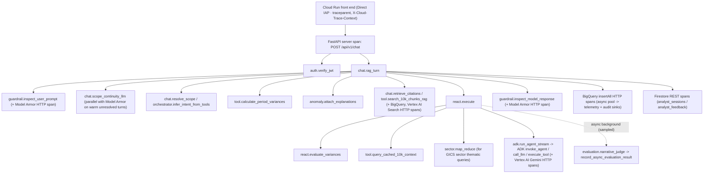

# Observability: Cloud Trace, Cloud Logging, Cloud Monitoring & BigQuery

The FastAPI service exports **OpenTelemetry spans to Cloud Trace** and writes **structured JSON logs carrying trace IDs** to stdout. Cloud Run ingests those logs into **Cloud Logging**. A single `/api/v1/chat` request produces one trace covering the Cloud Run front end, FastAPI, guardrails, synthesis steps, tools, ADK model calls, and outbound GCP REST calls. That request's log lines appear grouped under the trace, and its BigQuery telemetry rows carry the same `trace_id`.

Everything is operated from the **Google Cloud Console**: two Cloud Monitoring dashboards, low-cardinality log-based metrics, alert policies, and BigQuery SQL views queried from BigQuery Studio.

Code lives in [`src/edgar_capstone/observability/`](../src/edgar_capstone/observability):

| Module | Responsibility |
| :-- | :-- |
| `tracing.py` | `TracerProvider` + `LoggerProvider` exporting over OTLP/HTTP to `telemetry.googleapis.com` via ADK's `google_cloud.get_gcp_exporters(...)` (plus local `console` / `otlp` exporters), GCP resource detection, sampling, propagators (`traceparent` + `X-Cloud-Trace-Context`), FastAPI / Google GenAI SDK / httpx auto-instrumentation, `@traced` / `start_span` helpers |
| `structured_logging.py` | `CloudLoggingJsonFormatter` (Cloud Logging special fields + Error Reporting), local trace-aware text formatter, uvicorn log routing |
| `middleware.py` | `RequestTelemetryMiddleware`: request log context, `X-Trace-Id` / `X-Request-Id` / `Server-Timing` response headers, one `http_request_completed` access log per request |

## Trace anatomy



- **Server span:** `opentelemetry-instrumentation-fastapi`. It continues the upstream W3C `traceparent` (or the legacy `X-Cloud-Trace-Context`), so Cloud Run's own request span and the app spans share one trace. Health probes and static assets are excluded (`EDGAR_TRACE_EXCLUDED_URLS`).
- **App spans:** `@traced(...)` on the chat engine (`chat.rag_turn`, `chat.resolve_scope`, `chat.scope_continuity_llm`, `chat.retrieve_citations`), intent fallback (`orchestrator.infer_intent_from_tools`; the analyst emits intent in `AnalystReport.intent`), anomaly explanation linker (`anomaly.attach_explanations`), synthesis (`react.execute`, `react.evaluate_variances`), sector map-reduce (`sector.map_reduce`), ADK runner (`adk.run_agent_stream`), Model Armor guardrail, JWT verification, and narrative evaluator (`evaluation.narrative_judge` asynchronously on sampled live turns via `EDGAR_ASYNC_JUDGE_SAMPLE_RATE` and synchronously during `make eval-all`). `with_tool_resilience` wraps every ADK `FunctionTool` in a `tool.<name>` span (returning structured error dicts on failure), while `retry_transient_errors` adds retry spans for propagating internal calls.
- **Model calls:** ADK's built-in `gcp.vertex.agent` spans (`invoke_agent`, `call_llm`, `execute_tool`) attach to the same global provider. Every recorded model call also adds an `llm.call` span event with `gen_ai.request.model`, input/output/cached/thinking tokens, `edgar.ttft_ms`, latency, and cost.
- **Outbound HTTP:** `opentelemetry-instrumentation-httpx` creates client spans for Vertex AI (google-genai), BigQuery, Discovery Engine, GCS, Firestore, and Model Armor, and propagates context on them.
- **Thread hops:** `_run_coro_sync` (persistent background ADK `asyncio` event loop), `POST /api/v1/chat/stream` SSE worker threads, `sector.map_reduce` batch pools, and the async judge pool (`_BackgroundJudgeManager`) all copy `contextvars` (`contextvars.copy_context().run` / `loop.create_task(coro, context=ctx)`), so live ADK runs, map-reduce batches, and async judge evaluations stay correlated under the parent request trace.
- **Error & mid-stream access logging:** `RequestTelemetryMiddleware` emits `http_request_completed` inside a `finally` block so latency metrics and trace-linked access logs are recorded even when an unhandled exception raises HTTP `500`. If an exception occurs mid-stream after headers are already flushed (e.g., SSE on `/api/v1/chat/stream`), the original HTTP status code is preserved and the log sets `unhandled_exception: true` and `stream_aborted: true` (alongside an `http_request_failed` exception log at `ERROR`).
- **Shutdown flushing:** FastAPI's lifespan shutdown hook drains pending background judge evaluations (`flush_pending_evaluations`), flushes async BigQuery streaming inserts (`flush_async_writes`), closes telemetry/feedback stores (`reset_telemetry_stores`), and flushes OpenTelemetry trace spans (`flush_tracing`).

## Structured log format

Example `http_request_completed` access log line as written to stdout (`EDGAR_LOG_FORMAT=json`):

```json
{
  "severity": "INFO",
  "message": "POST /api/v1/chat -> 200 (704.8 ms)",
  "time": "2026-11-16T20:04:41.603000+00:00",
  "logger": "edgar_capstone.access",
  "logging.googleapis.com/sourceLocation": {"file": ".../middleware.py", "line": "178", "function": "_log_access"},
  "trace_id": "4bf92f3577b34da6a3ce929d0e0e4736",
  "span_id": "00d73528256086a3",
  "logging.googleapis.com/trace": "projects/iron-radio-514217-q7/traces/4bf92f3577b34da6a3ce929d0e0e4736",
  "logging.googleapis.com/spanId": "00d73528256086a3",
  "logging.googleapis.com/trace_sampled": true,
  "request": {"request_id": "4bf92f3577b34da6a3ce929d0e0e4736", "method": "POST", "path": "/api/v1/chat"},
  "event": "http_request_completed",
  "http_method": "POST",
  "http_path": "/api/v1/chat",
  "http_route": "/api/v1/chat",
  "http_status": 200,
  "latency_ms": 704.77,
  "unhandled_exception": false,
  "stream_aborted": false,
  "user_agent": "Mozilla/5.0 ...",
  "remote_ip": "10.128.0.12"
}
```

- Every logger in the process is covered: app modules, `uvicorn` / `uvicorn.error`, and third-party libraries. They all go through one root handler. Uvicorn's own access log is turned off because the middleware's access log replaces it with trace IDs and route templates.
- To add structured fields, use `logger.info("msg", extra={"json_fields": {...}})`. Other non-standard `extra=` keys are included too.
- Every ERROR+ line carries `serviceContext` (`service` = `K_SERVICE`, `version` = `COMMIT_SHA` / `K_REVISION`). `logger.exception(...)` (ERROR+ with a traceback) also adds the Error Reporting `@type` and `context.reportLocation`, so stack traces appear in Cloud Error Reporting. Plain error lines (for example 5xx access logs) deliberately skip `@type` so they don't open one Error Reporting group per path/latency message; they still show in the dashboard's *Operational errors* logs panel.
- Telemetry sink records (`edgar_capstone.cloud_logging_sink`, `telemetry.py:emit_cloud_logging_sink_record`) write `component="sec-edgar-telemetry-sink"`, `log_sink_target` (`llm_telemetry_events` \| `session_telemetry_events` \| `security_audit_logs`), and `event_payload` as top-level `jsonPayload` fields, feeding the `sec_edgar/*` Cloud Monitoring log-based metrics.
- Locally (`auto` without `K_SERVICE`), logs are readable text that still includes `[trace=… span=…]`.

## Correlation surfaces

| Where | What |
| :-- | :-- |
| Response headers | `X-Trace-Id`, `X-Request-Id`, `Server-Timing: app;dur=…` (exposed through CORS for the Vite dev UI) |
| `/api/v1/chat` body | `observability.trace_id`, `span_id`, `cloud_trace_resource`, and a `cloud_trace_url` console deep link |
| BigQuery | Nullable `trace_id` column in `llm_telemetry_events`, `session_telemetry_events`, and `security_audit_logs` (direct `insertAll` streaming) |
| Cloud Monitoring | `sec_edgar/api_request_latencies` (with trace exemplars) and the telemetry sink metrics below, charted on both dashboards; alert policies link back to the logs panels and traces |
| `/health` | `observability.tracing` (exporter, sampling, instrumentation state) and `observability.logging` |

## Guardrail audit attribution

Model Armor, SDP, and projection-filter guardrail blocks (`model_armor_{prompt,response}_blocked`, `projection_filter_*_blocked`, `sdp_sensitive_*_blocked`, `*_fail_closed`) are raised deep inside the ADK turn, where no `AuthenticatedUser` is threaded through. The chat router binds the authenticated principal for the duration of the turn (`security.auth.bind_audit_principal`), `contextvars` carries it across the SSE worker, the ADK loop, and parallel tool workers, and the guardrail service records its audit events with `inherit_request_principal=True`. The block is therefore attributed to the caller's email / identity provider / IAP verification state instead of `unauthenticated`. The `inherit_request_principal` flag on `record_security_audit_event` defaults to `False`, and events outside an authenticated request are recorded as `unauthenticated`. `trace_id` is always attached by the telemetry sink from the active span, or from the inbound `X-Cloud-Trace-Context` / `traceparent` fallback on Cloud Run.

## Cloud Monitoring dashboards

| Dashboard | Terraform | Contents |
| :-- | :-- | :-- |
| **SEC EDGAR RAG Vector Database — Chunk Health & Ingestion Monitoring** | `google_monitoring_dashboard.chunk_health_dashboard` (`monitoring.tf`) | Chunk health score, embedding / filing coverage, chunks by sector and section, anomalies, BigQuery query rate, chunk-health logs, API p50/p95/p99 by route |
| **SEC EDGAR Analyst — LLM Telemetry, Cost, Sessions & Security Audit** | `google_monitoring_dashboard.llm_observability_dashboard` (`observability.tf`) | Navigation tile (Trace Explorer, Logs Explorer, Error Reporting, Chunk Health dashboard, BigQuery Studio + SQL recipes); API request rate by route, responses by status class (2xx/4xx/5xx), server latency p50/p95/p99; LLM TTFT and end-to-end model latency p50/p95 by model & task; LLM calls by model, cache hit vs miss, TTFT SLO compliance; per-call USD cost and cache savings (mean/p95) and estimated USD/hour; interactive turns by intent and by `fact_check_passed`; scored evaluation mean/p50; security audit events by `event_type` and `status`; logs panels for operational errors, security audit logs, and LLM telemetry logs; project-wide Cloud Logging export error monitor |

`terraform output llm_observability_dashboard_url` / `chunk_health_monitoring_dashboard_url` print the Console links.

> [!NOTE]
> Request counts are read from the PromQL `_count` series of the `api_request_latencies` distribution (`logging_googleapis_com:user_sec_edgar_api_request_latencies_count`). In Cloud Monitoring filters, `REDUCE_COUNT` on a DISTRIBUTION metric counts time series, not requests. Percentiles use `ALIGN_DELTA` + `REDUCE_PERCENTILE_*`, which merges the distributions across series.

## Log-based metrics

All telemetry metrics filter on `resource.type="cloud_run_revision" AND resource.labels.service_name="sec-edgar-analyst" AND jsonPayload.component="sec-edgar-telemetry-sink"` plus the `log_sink_target` shown. Labels are bounded enums only: `session_id`, `user_email`, `trace_id`, `call_id`, and tickers are **never** metric labels. Boolean labels are strings (`"true"` / `"false"`).

| Metric (`logging.googleapis.com/user/…`) | Kind | Source | Labels |
| :-- | :-- | :-- | :-- |
| `sec_edgar/api_request_latencies` | DISTRIBUTION, ms | `jsonPayload.event="http_request_completed"` → `latency_ms` | `http_route`, `http_method`, `http_status` |
| `sec_edgar/llm_ttft_ms` | DISTRIBUTION, ms | `llm_telemetry_events` → `ttft_ms` | `model_name`, `agent_name`, `task_category`, `within_ttft_slo` |
| `sec_edgar/llm_model_latency_ms` | DISTRIBUTION, ms | `llm_telemetry_events` → `total_model_latency_ms` | `model_name`, `agent_name`, `task_category` |
| `sec_edgar/llm_calls` | DELTA INT64 counter | `llm_telemetry_events` | `model_name`, `agent_name`, `task_category`, `cache_hit`, `within_ttft_slo` |
| `sec_edgar/llm_cost_usd` | DISTRIBUTION, 1 (USD) | `llm_telemetry_events` → `total_cost_usd` | `model_name`, `task_category` |
| `sec_edgar/llm_cache_savings_usd` | DISTRIBUTION, 1 (USD) | `llm_telemetry_events` → `cached_token_savings_usd` | `model_name`, `task_category` |
| `sec_edgar/session_turns` | DELTA INT64 counter | `session_telemetry_events` with `execution_mode!="async_evaluation"` | `intent`, `execution_mode`, `status`, `fact_check_passed`, `report_generated` |
| `sec_edgar/evaluation_scores` | DISTRIBUTION, 1 (0–1) | `session_telemetry_events` with `execution_mode="async_evaluation" AND evaluation_score>=0` (populated asynchronously on sampled verified turns via `EDGAR_ASYNC_JUDGE_SAMPLE_RATE`) | `intent`, `evaluation_grade` |
| `sec_edgar/security_audit_events` | DELTA INT64 counter | `security_audit_logs` | `event_type`, `status`, `identity_provider` |

LLM token reporting (`total_context_tokens`, `cached_context_tokens`, `uncached_context_tokens`, `output_tokens`, `thoughts_tokens`) lives exclusively in BigQuery (`sec_edgar.llm_telemetry_events` and `sec_edgar.v_telemetry_cost_and_latency`) rather than being duplicated in Cloud Monitoring. USD distributions use exponential buckets from `$0.0001` (scale `0.0001`, growth `1.5`, 29 buckets, about `$12.8` plus overflow). Log-based counter metrics count entries and cannot sum float fields, so the dashboard's USD tiles are **approximate**. Exact cumulative USD totals also come from BigQuery `sec_edgar.v_telemetry_cost_and_latency`.

## Alert policies

All policies are enabled and notify `var.monitoring_notification_channels`.

| Policy | Condition | Threshold variable |
| :-- | :-- | :-- |
| `api_latency_p95` | p95 of `api_request_latencies` on `/api/v1/chat(/stream)?` over 5 min | `api_latency_p95_alert_threshold_ms` (`30000`) |
| `api_5xx_errors` | PromQL `sum(increase(…api_request_latencies_count{http_status=~"5.."}[5m])) >= N` | `api_5xx_alert_threshold` (`5`) |
| `security_audit_blocks` | Sum of `security_audit_events` with `status` matching `denied_40[13]\|blocked.*` over 5 min `> N` | `security_block_alert_threshold` (`20`) |

## BigQuery telemetry streaming

`BigQueryTelemetrySink` streams schema-validated rows directly via `tabledata.insertAll` into `sec_edgar.llm_telemetry_events`, `session_telemetry_events`, and `security_audit_logs`. The runtime SA (`sec-analyst-sa`) only holds the append-only custom role `secEdgarTelemetrySinkAppend` (`bigquery.tables.get` + `bigquery.tables.updateData`) on those three tables, keeping `sec_edgar.financial_metrics` and `filing_chunks` strictly read-only. There is no duplicate Cloud Logging → BigQuery sink dataset; structured log lines stay in Cloud Logging to power the `sec_edgar/*` log-based metrics.

### SQL semantic views (BigQuery Studio)

| View | Grain | Highlights |
| :-- | :-- | :-- |
| `sec_edgar.v_telemetry_cost_and_latency` | day × model × agent × task | Exact token totals, `total_cost_usd`, `cached_token_savings_usd`, cache hit rate, avg/p95 TTFT & latency, TTFT SLO compliance |
| `sec_edgar.v_session_analytics_summary` | day × intent × execution_mode | Turn counts, latency, cost, and fact-check pass rate over interactive turns, separated from sampled async LLM-as-a-Judge `avg_evaluation_score` / `p50_evaluation_score` rows |
| `sec_edgar.v_security_audit_summary` | day × event_type × status × identity_provider | Totals, `denied_401` / `denied_403` / blocked counts, distinct principals, IAP-verified events, distinct traces |

```sql
-- Exact LLM spend and cache savings, last 7 days
SELECT telemetry_date, model_name, SUM(call_count) AS calls,
       ROUND(SUM(total_cost_usd), 4) AS cost_usd,
       ROUND(SUM(cached_token_savings_usd), 4) AS cache_savings_usd,
       ROUND(SAFE_DIVIDE(SUM(cached_context_tokens), SUM(total_context_tokens)), 4) AS cached_token_share
FROM `iron-radio-514217-q7.sec_edgar.v_telemetry_cost_and_latency`
WHERE telemetry_date >= DATE_SUB(CURRENT_DATE(), INTERVAL 7 DAY)
GROUP BY 1, 2 ORDER BY 1 DESC, cost_usd DESC;

-- Session volume, latency, and spend by intent
SELECT session_date, intent,
       SUM(interactive_turn_count) AS turns,
       ROUND(AVG(p95_turn_latency_ms)) AS p95_turn_latency_ms,
       ROUND(SUM(total_cost_usd), 4) AS cost_usd
FROM `iron-radio-514217-q7.sec_edgar.v_session_analytics_summary`
GROUP BY 1, 2 ORDER BY 1 DESC, turns DESC;

-- Security audit trail: denials, guardrail blocks, IAP-verified events
SELECT audit_date, event_type, status, identity_provider,
       total_events, denied_events, blocked_events, distinct_principals, iap_verified_events
FROM `iron-radio-514217-q7.sec_edgar.v_security_audit_summary`
WHERE audit_date >= DATE_SUB(CURRENT_DATE(), INTERVAL 30 DAY)
ORDER BY audit_date DESC, total_events DESC;

-- Who triggered guardrail blocks (row-level, joinable to Cloud Trace)
SELECT recorded_at, event_type, user_email, identity_provider, detail, trace_id
FROM `iron-radio-514217-q7.sec_edgar.security_audit_logs`
WHERE STARTS_WITH(status, 'blocked') AND DATE(recorded_at) >= DATE_SUB(CURRENT_DATE(), INTERVAL 7 DAY)
ORDER BY recorded_at DESC;
```

> [!TIP]
> Any of these views can be explored interactively in BigQuery Studio via **Explore data → Explore with Looker Studio**.

## Correlation walkthrough (one request end-to-end)

1. Send a chat turn and capture the trace ID: `curl -si … /api/v1/chat … | grep -i x-trace-id`. The SSE `connected` event and the response `observability.trace_id` carry the same ID.
2. **Cloud Trace:** Trace Explorer → filter `service.name: sec-edgar-analyst`, or paste the ID. The waterfall shows the FastAPI server span, `chat.rag_turn`, guardrails, ReAct/tool spans, ADK `call_llm` spans, and httpx calls to Vertex AI / BigQuery / Firestore.
3. **Cloud Logging:** `trace="projects/iron-radio-514217-q7/traces/<TRACE_ID>"` groups the access log, app logs, and the three telemetry sink records (`jsonPayload.log_sink_target`) under the request. From a trace span, *View logs* opens the same query.
4. **BigQuery:** join the streamed rows on the same ID:
   ```sql
   SELECT 'llm' AS src, recorded_at, model_name AS detail FROM `iron-radio-514217-q7.sec_edgar.llm_telemetry_events` WHERE trace_id = @trace_id
   UNION ALL SELECT 'session', recorded_at, CONCAT(intent, ' / ', execution_mode) FROM `iron-radio-514217-q7.sec_edgar.session_telemetry_events` WHERE trace_id = @trace_id
   UNION ALL SELECT 'audit', recorded_at, CONCAT(event_type, ' / ', status) FROM `iron-radio-514217-q7.sec_edgar.security_audit_logs` WHERE trace_id = @trace_id
   ORDER BY recorded_at;
   ```
5. **Cloud Monitoring:** latency points on `api_request_latencies` keep trace exemplars, so a spike on either dashboard links back to the trace that caused it.

## Configuration

| Variable | Default | Purpose |
| :-- | :-- | :-- |
| `EDGAR_TRACING_ENABLED` | `true` | Master switch (`OTEL_SDK_DISABLED=true` also disables tracing) |
| `EDGAR_TRACE_EXPORTER` | `auto` | `auto` (Cloud Trace on Cloud Run, in-process only elsewhere) \| `gcp` \| `console` \| `otlp` \| `none` |
| `EDGAR_TRACE_SAMPLE_RATIO` | `1.0` | Head sampling ratio. A sampled upstream parent is always honored. |
| `EDGAR_TRACE_CAPTURE_CONTENT` | `false` | Default for ADK `ADK_CAPTURE_MESSAGE_CONTENT_IN_SPANS`. Keeps prompts, 10-K text, and model output out of Cloud Trace. |
| `EDGAR_TRACE_EXCLUDED_URLS` | health + static assets | Comma-separated regexes that get no server span |
| `EDGAR_TRACE_INSTRUMENT_HTTPX` | `true` | Outbound httpx client spans |
| `EDGAR_LOG_FORMAT` | `auto` | `json` on Cloud Run, `text` locally |
| `EDGAR_LOG_LEVEL` | `INFO` | Root log level |
| `EDGAR_ASYNC_JUDGE_SAMPLE_RATE` | `1.0` | Probability in `[0.0, 1.0]` for running the off-critical-path async LLM-as-a-Judge on verified live turns (`0.0` disables live background judging; `0 < r < 1` samples turns) |
| `OTEL_SERVICE_NAME` / `K_SERVICE`, `COMMIT_SHA` | — | `service.name` / `service.version` resource attributes |

Terraform enables `cloudtrace.googleapis.com` and `logging.googleapis.com` in `terraform/apis.tf` and grants `sec-analyst-sa` `roles/cloudtrace.agent` and `roles/logging.logWriter` in `terraform/iam.tf`. With `EDGAR_TRACE_EXPORTER=auto` and `EDGAR_LOG_FORMAT=auto`, Cloud Run is detected automatically.

> [!TIP]
> Spans are exported in batches on a background thread. With Cloud Run's default request-based CPU allocation, an idle instance may hold spans until the next request or shutdown, when the lifespan hook flushes them. If you need spans to show up within seconds even under low traffic, deploy with `--no-cpu-throttling` (instance-based billing).

## Local usage

```bash
# Spans printed to stdout, JSON logs locally
EDGAR_TRACE_EXPORTER=console EDGAR_LOG_FORMAT=json make backend

# Send local spans to Cloud Trace with ADC
gcloud auth application-default login
EDGAR_TRACE_EXPORTER=gcp GOOGLE_CLOUD_PROJECT=iron-radio-514217-q7 make backend

curl -si -X POST localhost:8000/api/v1/chat -H "Authorization: Bearer $TOKEN" \
  -H 'Content-Type: application/json' -d '{"query":"Compare NVDA and AAPL revenue 2024-2026"}' \
  | grep -i -E 'x-trace-id|server-timing'
```

## Finding a request in GCP

- **Cloud Trace:** Trace Explorer, filter on `service.name: sec-edgar-analyst` or paste the `X-Trace-Id`.
- **Cloud Logging:** `trace="projects/iron-radio-514217-q7/traces/<TRACE_ID>"`, or `jsonPayload.event="http_request_completed" AND jsonPayload.latency_ms > 10000` to find slow requests.
- **BigQuery:** `SELECT * FROM sec_edgar.llm_telemetry_events WHERE trace_id = '<TRACE_ID>'` (same for `session_telemetry_events` / `security_audit_logs`).
- **Cloud Monitoring:** the *LLM Telemetry, Cost, Sessions & Security Audit* dashboard and its logs panels.

Tests: [`tests/test_observability.py`](../tests/test_observability.py) checks the span hierarchy with an in-memory exporter, upstream `traceparent` / `X-Cloud-Trace-Context` propagation, response headers, the JSON log format and trace fields, uvicorn routing, and `trace_id` on telemetry rows. [`tests/test_cloud_console_observability.py`](../tests/test_cloud_console_observability.py) covers the log-based metric definitions (low-cardinality labels), alert policies, dashboard widgets and layout, append-only BigQuery telemetry IAM (with no duplicate log sink), the SQL views, the Cloud Run label-collision guard, guardrail audit principal and trace attribution, and the Error Reporting fields.
