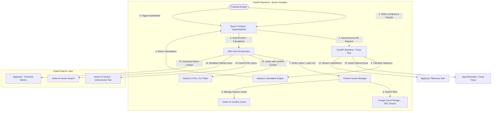

# Project Reference: SEC EDGAR Natural Language Analyst

## 1. Overview
Automate the generation of period-over-period financial variance reports from SEC 10-K filings. A conversational agentic interface that allows financial analysts to perform complex natural language queries across dense SEC filings and structured financial data using hybrid search.

The system:
- **Separates calculation from synthesis:** Performs deterministic variance calculations for Revenue, Operating Income, and Net Income.
- **Grounds narratives with citations:** Generates explanations cited directly to the source 10-K sections, displayed in a split-pane source viewer.
- **Leverages Hybrid Search:** Unifies retrieval of structured financial metrics and unstructured 10-K text.
- **Enables Longitudinal Tracking:** Tracks specific thematic shifts (e.g., AI-related risk disclosures) across multiple fiscal periods (2024-2026).

Supported query types: longitudinal data for a single company, multi-company comparisons over multiple years, and thematic shifts across fiscal periods.

---

## 2. Scope

### In Scope
- **Conversational Agentic Architecture:** Root Orchestrator with intent routing for longitudinal analysis, peer comparison, and thematic trend tracking.
- **Hybrid Search & Data Foundation:** Ingestion of SEC 10-K filings into Vertex AI Search and Vector Search, with structured metrics in BigQuery for metadata-filtered RAG.
- **External API Tool Integrations:** Mock calculation engines and data retrieval tools with robust rate-limiting and retry logic.
- **Security & Safety Integrations:** SPIFFE-based Agent Identities, Secret Manager, and VPC Service Controls.
- **Observability Setup:** OpenTelemetry (OTEL) and Google Cloud Trace integration for end-to-end latency tracing.
- **Automated Verification:** pytest suite (see Testing & Evaluation).

### Out of Scope
- Integration with live SEC EDGAR RSS feeds (static curated datasets will be used).
- Live production deployment to external client-facing portals.
- Anything not explicitly mentioned in this Project Scope.

---

## 3. User Journey
1. **Chat-Based Request:** The analyst chats a request, such as "Compare NVIDIA and Apple's R&D spend from 2024-2026" or "How has the wording on AI risk changed across all tech companies in the S&P 500 since 2024?"
2. **Hybrid Retrieval:** The agent triggers a hybrid search (e.g. Vertex AI Search + BigQuery) to retrieve both qualitative risk text and quantitative financial metrics.
3. **Multi-Period Synthesis:** The backend utilizes Gemini to synthesize thematic changes over the requested range of years, highlighting specific delta in wording.
4. **Agentic Synthesis:** The backend retrieves the relevant 10-K filing and data from Agent Search / BigQuery, using the calculated variances as grounding facts.
5. **Review Grounded Output:** The analyst views the generated narrative report in a split-pane view, with inline citations linked to the exact sections of the 10-K (e.g., MD&A or Risk Factors) displayed on the right.

---

## 4. Success Criteria
- **Accuracy:** 100% agreement between the numbers presented in the narrative report and the deterministic calculation engine outputs.
- **Hallucinations:** Minimize via strict grounding enforcement using cached 10-K.
- **Grounded Citations:** 100% of narrative claims are cited and traceable back to the source 10-K document.
- **Latency:** p95 latency <= 3.0 seconds "Time to First Thought".
- **Grounding Recall:** >=92% relevance mapping when extracting explanation text from the 10-K.
- **Toxicity / Injection Redaction:** 100% safety compliance for financial projections and prompt safety.
- **RAG Retrieval Precision:** Unified retrieval across structured financial metrics and unstructured text using hybrid search with metadata filtering.
- **Operational:** Containerized via Docker, provisioned entirely via Terraform, and deployed to Google Cloud Run.
- **Observability:** OpenTelemetry and Cloud Trace setup, export to BigQuery telemetry, and operational logging.

---

## 5. Technology Stack
- **Runtime:** Python 3.11+ / FastAPI
- **Frontend:** React 18+ / TypeScript / Tailwind CSS (Vite)
- **Orchestration:** Google ADK / AGY SDK
- **Models:** Gemini 2.5 Pro (for financial reasoning), Gemini 3.5 Flash (for coding and evals)
- **Infrastructure:** Google Cloud Run, Cloud Storage, Gemini Enterprise Agent Platform, BigQuery, Secret Manager, VPC Service Controls, OpenTelemetry, Cloud Trace
- **IaC / Packaging:** Terraform, Docker
- **CI/CD:** Cloud Build

---

## 6. System Architecture

### High-Level Diagram

### Architecture Principles
- **Modularity:** The calculation engine, the context cache manager, and the ADK orchestrator are independent, allowing models and calculation logic to be updated without modifying other components.
- **Scalability:** Hosted on Google Cloud Run with automated scaling bounds to handle multiple concurrent analyst sessions.
- **Resilience:** Retry policies with exponential backoff for Vertex AI API calls. Fallbacks to handle cache misses gracefully.
- **Hybrid Data Foundation:** Vertex AI Search and Vector Search with BigQuery provide a unified data foundation for metadata-filtered RAG.

### Agents & Tools (ADK)
- **RootOrchestrator:** Central supervisor.
- **FinancialAnalystAgent:** Reasoning and extracting narrative explanations from the 10-K.
- **LookerQueryTool / MetricFetchTool:** Helper tools to retrieve raw metrics.
- **Variance Calculation API:** Performs deterministic variance calculations for Revenue, Operating Income, and Net Income.
- **Reasoning Strategy:** Structured ReAct execution loop. The agent evaluates the calculated variances, queries the cached 10-K context for explanation, and formats the output.
- **Context & Memory:** Track latency due to context in model calls.
- **Tool Registration:** Tool definitions (e.g. calculation engine endpoints) are registered natively inside the ADK framework using explicit Pydantic type schemas.
- **Function Calling Logic:** Standardized exception wrappers handle API rate limits (HTTP 429) and timeouts.

---

## 7. Data

### Sources
- **SEC EDGAR 10-K Filings:** Curated set of Markdown/Text files representing Item 1A (Risk Factors) and Item 7 (MD&A) for the full S&P 500. Stored in a GCS bucket (`gs://fde-sec-edgar-sandbox-dev-sec-corpus/`). Year range from 2020 to as recent as possible.
- **Structured Financial Metrics:** JSON parsed data containing Revenue, Operating Income, and Net Income for the corresponding periods.
- **Data Policy:** Only public information.

### Retrieval Strategy
- **Hybrid Search RAG:** Combines Vertex AI Search (unstructured text retrieval), Vertex AI Vector Search (semantic retrieval), and BigQuery (structured financial metrics). Facilitates metadata-filtered RAG for longitudinal thematic tracking and multi-company comparisons.
- **GEAP Agent Search (fka. Vertex AI Search):** Used as initial document locator or for searching cross-document trends.
- **Access Pattern:** Real-time narrative synthesis using Gemini Context Caching.

---

## 8. Infrastructure, Security & IAM

### Environment
- **Dev Project ID:** `iron-radio-514217-q7` (Display Name: `fde-sec-edgar-sandbox-dev`; Vertex AI, Cloud Run, GCS, BigQuery, and Secret Manager APIs active)
- **Region:** `us-central1`
- **Deployment Topology:** 100% self-contained inside the Argolis sandbox.
- **Repository:** GTM Cloud-GTM GitHub Enterprise organization.
- **Dev Tooling:** JetSki / AGY 2.0 with Gemini 3.5 Flash assistance.

### AuthN / AuthZ
- **Identity Provider:** Google Workspace Okta/SSO.
- **API Access:** Internal APIs are protected using Identity-Aware Proxy (IAP), requiring JWT-based bearer authentication.
- **RBAC:** Group-based access definitions managed via Cloud Identity Groups.
- **Service Account:** `sec-analyst-sa@<project name>.iam.gserviceaccount.com` (e.g. `fde-sec-edgar-sandbox-dev` for dev)
- **Agent Identities:** Granular, per-agent identities enforce Least Privilege for service-to-service communication.

### Data Protection
- **Encryption:** 100% of data is encrypted in transit using TLS 1.3. GMEK protects Data-at-Rest.
- **VPC Service Controls (VPC-SC):** A strict service perimeter locks down Vertex AI, Cloud Run, GCS, and BigQuery.
- **PII / Sensitive Data:** Standard filters check for sensitive internal data or financial projection leaks.
- **Secrets:** Secret Manager.

### AI Safety & Prompt Management
- **Model Armor:** Redacts toxic content, prompt injection attempts, and prevents jailbreaks.
- **Strict Grounding Lock:** Force the model to only explain variances using the provided text, refusing external general knowledge queries.
- **Fact Checks:** Post-generation verification comparing output values against calculation values.
- **Prompt Lifecycle:** Prompts are stored in a versioned repository and loaded dynamically.

### CI/CD
- Deployed via Cloud Build triggered automatically upon successful Git merges.
- The pipeline executes formatting checks, lints, and triggers the pytest suite.

---

## 9. Testing & Evaluation
- **Automated Verification:** pytest suite with mocked LLM and Search APIs, achieving >80% code coverage, including math verification and regression checks.
- **LLM-as-a-Judge:** Gemini 3.5 Flash evaluates narrative faithfulness, explanation quality, and thematic consistency against the golden dataset.
- **Ground Truth:** A golden dataset of 20+ query-variance-explanation mappings stored in BigQuery is used to run regression checks (e.g. `make eval-all`) before deployment.

---

## 10. Analytics, Observability & Audit
- **User Feedback:** Frontends log thumbs-up/down feedback and custom comments directly into a collections table (e.g. CloudSQL, FireStore).
- **Session Metrics:** Session length, companies analyzed, and report generation counts.
- **Usage & Cost:** Logs token consumption (including cached token discount savings) to BigQuery.
- **Performance:** Captures TTFT (Time to First Token) and total latency.
- **BI Dashboards:** Exported to Looker to visualize tool usage, average latency, and estimated cost savings from caching.
- **Logging:** FastAPI backend produces structured JSON logs containing trace IDs, exported directly to Cloud Logging.
- **Audit Trails:** Logs track who accessed which company's 10-K report and when.

---

## 11. Build Sequence (example for reference only)
| Sprint | Phase | Tasks |
|---|---|---|
| 1 | Discovery | Initialize repo, draft architecture diagrams, configure GCS & layout for SEC filings. |
| 2 | Grounding | Write variance calculation engine, load mock financial data, verify data loading. |
| 3 | Orchestration | Develop ADK Root Agent, set up context caching, build React UI. |
| 4 | Security & Evals | Configure Secret Manager, OpenTelemetry tracing, and write tests with math evaluation checks. |
| 5 | Deployment | Write Dockerfile, Terraform, CI/CD integrations, and deploy to Google Cloud Run. |
| 6 | Disengagement | Sanitize code: generalize the financial routing configurations, remove domain-specific secrets, and push reusable components to the central repository. |

