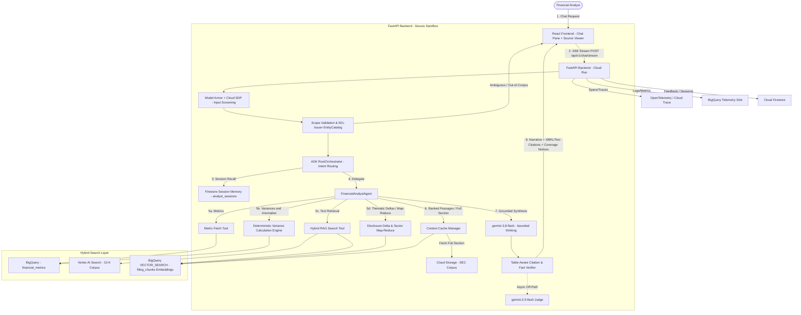

# Project Reference: SEC EDGAR Natural Language Analyst

## 1. Overview
A conversational, agentic interface that lets financial analysts ask complex natural language questions across SEC 10-K filings and structured financial data, replacing static dashboards. The system automates period-over-period financial variance reporting and longitudinal thematic analysis using hybrid search, deterministic calculation, and grounded Gemini synthesis.

The system:
- **Understands conversational queries across time and entities:** Single-company longitudinal questions, multi-company peer comparisons, and sector-wide thematic questions (e.g., "all tech companies in the S&P 500").
- **Separates calculation from synthesis:** All arithmetic (variances, growth rates, margins) is performed by a deterministic calculation engine; the LLM never computes numbers.
- **Explains financial anomalies:** Material variances are flagged deterministically and explained using grounded 10-K text (MD&A, Risk Factors).
- **Leverages hybrid search with filtering:** Unifies retrieval of structured financial metrics (BigQuery) and unstructured 10-K text (Vertex AI Search / vector search) with metadata filters (ticker, fiscal year, GICS sector, 10-K section).
- **Tracks themes longitudinally:** Generates narratives and trend analysis (e.g., AI-related disclosures) across FY2024, FY2025, and FY2026 filings, highlighting specific changes in wording.
- **Grounds every claim with citations:** 100% of narrative claims cite the source 10-K, displayed in a split-pane source viewer.

Supported query types (routing intents): `longitudinal_single_company`, `multi_company_peer_comparison`, and `thematic_trend_tracking` (plus the operational `chunk_health_monitoring` intent).

---

## 2. Objectives

### Business Objectives
| # | Objective | Description |
|---|---|---|
| B1 | **Enable Natural Language Discovery** | Shift from static dashboards to a conversational interface that understands complex financial queries across time and entities. |
| B2 | **Ensure Mathematical Accuracy** | Eliminate LLM-generated math errors by separating calculation logic from narrative synthesis on Revenue, Operating Income, and Net Income. |
| B3 | **Accelerate Decision Making** | Provide analysts with grounded explanations of financial anomalies. |

### Technical Objectives
| # | Objective | Description |
|---|---|---|
| T1 | **Implement Hybrid Search** | Leverage hybrid search with filtering to demonstrate unified retrieval of structured data and unstructured text. |
| T2 | **Longitudinal Thematic Tracking** | Generate narratives and trend analysis (e.g., "AI trends") across 2024, 2025, and 2026 filings. |
| T3 | **Grounded Citations** | Ensure 100% of narrative claims are cited and traceable back to the source 10-K document. |

### Objective Traceability
| Objective | Delivered By | Measured By (§5) |
|---|---|---|
| B1 | Chat UI, RootOrchestrator intent routing, session memory (§7) | Intent routing accuracy, latency |
| B2 | Deterministic Variance Calculation Engine (§7) | Numerical accuracy |
| B3 | Deterministic anomaly flagging + grounded MD&A/Risk Factor explanations (§7) | Grounding recall, LLM-as-a-Judge explanation quality |
| T1 | BigQuery metrics + Vertex AI Search / vector search with metadata filters (§8) | Retrieval precision@k |
| T2 | Disclosure Delta pipeline over FY2024–FY2026 Item 1A / Item 7 (§7) | Thematic consistency, wording-delta accuracy |
| T3 | Citation model + post-generation citation verifier (§8, §9) | Citation coverage, citation precision |

---

## 3. Scope

### In Scope
- **Conversational Agentic Architecture:** Root Orchestrator with intent routing for longitudinal analysis, peer comparison, and thematic trend tracking; multi-turn sessions with follow-up refinement.
- **Deterministic Calculation Engine:** Period-over-period and YoY variances for the core metrics (Revenue, Operating Income, Net Income) and the supported extended metric R&D expense.
- **Hybrid Search & Data Foundation:** Ingestion of SEC 10-K filings (Item 1A, Item 7) into Vertex AI Search and vector search, with structured metrics in BigQuery for metadata-filtered RAG.
- **Longitudinal Thematic Tracking:** Year-over-year disclosure comparison for a theme across FY2024–FY2026 for a single company, a peer set, or a GICS sector.
- **Split-Pane Grounded Report UI:** Chat pane with inline citations linked to a source viewer that highlights the cited 10-K passage.
- **External API Tool Integrations:** Data retrieval and calculation tools with robust rate-limiting and retry logic.
- **Security & Safety Integrations:** SPIFFE-based Agent Identities, Secret Manager, VPC Service Controls, Model Armor.
- **Observability Setup:** OpenTelemetry (OTEL) and Google Cloud Trace integration for end-to-end latency tracing.
- **Automated Verification:** pytest suite and golden-dataset evaluations (see §10).

### Out of Scope
- Integration with live SEC EDGAR RSS feeds (static curated datasets will be used).
- Filing types other than 10-K (e.g., 10-Q, 8-K, proxy statements).
- Issuers outside the S&P 500 constituent snapshot.
- Forward-looking projections, investment recommendations, or price targets.
- Live production deployment to external client-facing portals.

---

## 4. User Journey
1. **Chat-Based Request:** The analyst chats a request, such as "Compare NVIDIA and Apple's R&D spend from 2024-2026" or "How has the wording on AI risk changed across all tech companies in the S&P 500 since 2024?" The orchestrator resolves scope (tickers or GICS sector, fiscal years, metrics, theme) and asks a clarifying question if the scope is ambiguous or unsupported.
2. **Hybrid Retrieval:** The agent triggers a filtered hybrid search: BigQuery for quantitative financial metrics and Vertex AI Search / vector search for qualitative 10-K text (Risk Factors, MD&A), filtered by ticker, fiscal year, GICS sector, and section.
3. **Deterministic Grounding Facts:** The calculation engine computes variances (absolute, %, bps of margin/intensity) and flags material anomalies. For thematic queries, the Disclosure Delta pipeline aligns each company's passages for the theme across consecutive fiscal years and classifies them as added, removed, or modified.
4. **Grounded Multi-Period Synthesis:** Gemini synthesizes the narrative using only the calculated variances, disclosure deltas, and retrieved 10-K passages as grounding facts, highlighting specific changes in wording and explaining anomalies.
5. **Review Grounded Output:** The analyst views the generated narrative report in a split-pane view, with inline citations linked to the exact sections of the 10-K (e.g., MD&A or Risk Factors) displayed on the right. The analyst can ask follow-up questions (e.g., "Now add Microsoft") within the same session.

---

## 5. Success Criteria
| Category | Target | Objective |
|---|---|---|
| **Numerical Accuracy** | 100% agreement between every number in the narrative report and the deterministic calculation engine output (Revenue, Operating Income, Net Income, and R&D when requested). | B2 |
| **Citation Coverage** | 100% of narrative claims carry at least one citation traceable to the source 10-K (see Citation Model, §8). | T3 |
| **Citation Precision** | >= 95% of citations resolve to a passage that supports the claim (LLM-as-a-Judge + spot audit). | T3 |
| **Hallucinations** | Zero unsupported claims on the golden dataset; enforced via strict grounding and post-generation verification. | B2, T3 |
| **Grounding Recall** | >= 92% relevance mapping when extracting explanation text from the 10-K. | B3 |
| **Retrieval Precision** | >= 85% precision@10 for filtered hybrid retrieval on the golden dataset, with 100% metadata-filter correctness (no out-of-scope ticker, year, sector, or section returned). | T1 |
| **Thematic Tracking** | Narratives cover each requested fiscal year (FY2024–FY2026) with available filings; >= 90% wording-delta accuracy (added/removed/modified) against golden annotations. | T2 |
| **Intent Routing** | >= 95% correct intent classification on the golden dataset. | B1 |
| **Latency** | p95 <= 3.0 seconds Time to First Token (TTFT: first streamed response token, including a streamed reasoning/status step) for single- and peer-company queries; sector-wide thematic queries stream progress within 3.0 seconds. | B1, B3 |
| **Toxicity / Injection Redaction** | 100% safety compliance for financial projections and prompt safety. | — |
| **Operational** | Containerized via Docker, provisioned entirely via Terraform, and deployed to Google Cloud Run. | — |
| **Observability** | OpenTelemetry and Cloud Trace setup, export to BigQuery telemetry, and operational logging. | — |

---

## 6. Technology Stack
- **Runtime:** Python 3.11+ / FastAPI
- **Frontend:** React 18+ / TypeScript / Tailwind CSS (Vite)
- **Orchestration:** Google ADK / AGY SDK
- **Models:** `gemini-3.8-flash` for financial reasoning and orchestration (`RootOrchestrator`, `FinancialAnalystAgent`), served from the Vertex AI `global` endpoint; `gemini-3.5-flash` for evaluation (LLM-as-a-Judge), coding assistance, and context compaction. Both are configurable (`EDGAR_ANALYST_MODEL`, `EDGAR_FLASH_MODEL`).
- **Infrastructure:** Google Cloud Run, Cloud Storage, Vertex AI Search, BigQuery (`financial_metrics` + `VECTOR_SEARCH` over `filing_chunks` embeddings), Cloud Firestore (`analyst_sessions` + `analyst_feedback`), Vertex AI Context Caching, Secret Manager, Model Armor + Cloud SDP/DLP, OpenTelemetry, Cloud Trace, Cloud Monitoring (optional VPC Service Controls perimeter and opt-in Vertex AI Vector Search index deployment)
- **IaC / Packaging:** Terraform, Docker
- **CI/CD:** Cloud Build (`cloudbuild.yaml`) & GitHub Actions (`.github/workflows/deploy.yml`, keyless WIF)

---

## 7. System Architecture

### High-Level Diagram

### Request Flow
1. **Scope resolution:** Extract tickers or GICS sector, fiscal-year range, metrics, and theme from the query and session memory; ask a clarifying question if required fields are ambiguous or outside the corpus.
2. **Intent routing:** Classify the query as `longitudinal_single_company`, `multi_company_peer_comparison`, or `thematic_trend_tracking`.
3. **Deterministic facts:** Fetch metrics and compute variances and anomaly flags (quantitative intents); compute disclosure deltas (thematic intent).
4. **Retrieval:** Run filtered hybrid search for supporting 10-K passages; load full sections from the context cache when deep reading is required.
5. **Synthesis:** Gemini writes the narrative, restricted to grounding facts.
6. **Verification:** Every number is checked against calculation output and every claim is checked for a valid citation before the response is released.

### Architecture Principles
- **Calculation / Synthesis Separation:** The LLM receives pre-computed numbers and disclosure deltas as facts; it never performs arithmetic or invents comparisons.
- **Modularity:** The calculation engine, retrieval tools, context cache manager, and ADK orchestrator are independent, allowing models and calculation logic to be updated without modifying other components.
- **Scalability:** Hosted on Google Cloud Run with automated scaling bounds to handle multiple concurrent analyst sessions. Sector-wide thematic queries use a full-sector batched fan-out / map-reduce pattern (`agents/sector_map_reduce.py`: single BigQuery `ML.DISTANCE` + `QUALIFY ROW_NUMBER()` query over all matching issuers in the GICS sector, deterministic `build_company_evolution`, parallel `gemini-3.5-flash` map batches of ~14 issuers with quote verification, and `gemini-3.8-flash` reduce synthesis) rather than loading every filing into one context. Progress streams over SSE (`POST /api/v1/chat/stream`) within the 3.0 s TTFT target, while `POST /api/v1/chat` remains backward-compatible.
- **Latency & Async Evaluation:** A persistent background `asyncio` event loop (`agents/live_runtime.py`) reuses cached ADK `Gemini` clients (`@PerLoopCachedProperty` HTTP/2 keepalive pool + OAuth2 credential cache) and bounded thinking (`thinking_budget=512`), compacting redundant nested XBRL provenance metadata out of the LLM prompt copy (~10× smaller variance payload while preserving full provenance in API/UI/rendered output). Live Flash LLM-as-a-Judge runs asynchronously off the interactive request path (flushed on shutdown); `evals/runner.py` invokes the judge directly with `reference_explanation`.
- **Resilience:** Retry policies with exponential backoff for Vertex AI and BigQuery calls, plus bounded thread-safe query-embedding caching (`vector_db/embedder.py`). There is no offline or local-data fallback: retrieval always uses live BigQuery, Vertex AI Search, Vertex AI embeddings, and the GCS corpus, and every answer is written by live Gemini. If all findings in a live Gemini report fail verification on the first pass, a single verification-guided regeneration attempt runs with exact verifier rejection reasons; if still unverifiable, the answer is withheld (`answer_verified: false`) rather than replaced with template text; partial data coverage is reported deterministically via `coverage_notices`, not filled in.
- **Hybrid Data Foundation:** Vertex AI Search, BigQuery `VECTOR_SEARCH` over `filing_chunks`, and BigQuery `financial_metrics` share common metadata keys (`ticker`, `cik`, `fiscal_year`, `gics_sector`, `section_id`, `accession_number`) so structured and unstructured results join cleanly.

### Agents & Tools (ADK)
- **RootOrchestrator:** Central supervisor; scope resolution, session memory recall, and intent routing.
- **FinancialAnalystAgent:** Executes the ReAct loop: calls tools, evaluates variances and deltas, retrieves explanations, and formats the grounded report.
- **ContextCacheManager:** Loads and caches full 10-K sections (Item 1A, Item 7) for deep reading.
- **ContextCompactionSummarizer:** Compacts long multi-turn sessions to control context size and latency.
- **NarrativeEvaluatorAgent:** LLM-as-a-Judge for evaluation runs (faithfulness, explanation quality, thematic consistency).
- **Tools:**
  - `fetch_financial_metrics`: Retrieves structured metrics from BigQuery with ticker / year / sector filters.
  - `calculate_period_variances`: Deterministic multi-period and YoY variances for Revenue, Operating Income, Net Income, and R&D (absolute, %, and bps margin/intensity deltas).
  - `search_10k_chunks_rag`: Filtered hybrid retrieval over 10-K chunks.
  - `load_cached_10k_section` / `query_cached_10k_context`: Full-section context retrieval via Vertex AI Context Caching.
  - `query_looker_financial_explore`: Sector benchmarks and chunk-health explores backed by Looker/BigQuery views.
  - `flag_material_variances`: Deterministic anomaly flagging over the XBRL profiles (implemented in `agents/material_variances.py`). Rules and default thresholds (overridable via `EDGAR_MATERIALITY_<RULE>` environment variables):
    - **YoY change:** |YoY %| ≥ 25% for Revenue, Operating Income, Net Income, or R&D. Operating/Net Income changes must also be ≥ 1% of revenue, so tiny bases are not flagged.
    - **Sign reversal:** Operating Income or Net Income crosses zero year over year (always high severity).
    - **Margin shift:** YoY operating or net margin change ≥ 500 bps; R&D intensity change ≥ 200 bps.
    - **Period change:** start-to-end change ≥ 50% across a window of two or more years.
    - **Sector divergence:** YoY revenue growth ≥ 20 pp away from the GICS sector median (minimum 5 peers).
    - Flags at ≥ 2× threshold are high severity. Each flag carries the filing accession number, XBRL concept, and a suggested MD&A query; the top flags (one per company-year) are paired with an MD&A passage so the narrative explains the anomaly with a citation.
  - `compare_disclosures_across_years`: Disclosure Delta pipeline (see below; implemented in `agents/disclosure_deltas.py`).
- **Disclosure Delta Pipeline (Thematic Tracking):** For a theme (e.g., "AI risk"), retrieve the theme-relevant passages per company per fiscal year from Item 1A / Item 7 via hybrid search, then compare each passage with the adjacent year's full section using word-trigram coverage, which is insensitive to chunk boundaries moving between filings.
  - **Classification:** coverage ≥ 0.90 → *unchanged*; a counterpart chunk sharing ≥ 0.40 of the passage's trigrams → *modified*, with word-level added/removed phrases; otherwise *added* (current-year passage) or *removed* (prior-year passage).
  - **Theme mentions:** occurrences of the theme's key terms (with simple synonyms, e.g., "AI" → "artificial intelligence", "generative AI") are counted per fiscal year.
  - **Grounding:** the output is a deterministic, citable set of grounding facts that Gemini summarizes into trend narratives. Each delta cites both the prior-year and current-year passage, and missing fiscal years are reported as data gaps.
  - **Scope:** explicit tickers run `compare_disclosures_across_years` directly; sector-wide queries (`gics_sector != "ALL"` without explicit tickers) run the full-sector batched map-reduce pipeline (`agents/sector_map_reduce.py`), covering every in-scope issuer that has filings in BigQuery and emitting real-time `sector_map_progress` SSE events.
- **Reasoning Strategy:** Structured ReAct execution loop (`prompts/v5/financial_analyst.yaml`). The agent evaluates calculated variances and disclosure deltas, synthesizes directly when boundary-balanced evidence leads suffice or queries 10-K context via bounded tools, and outputs constrained `AnalystReport` JSON (no uncited `notes` field).
- **Tool Registration:** Tool definitions are registered natively inside the ADK framework using explicit Pydantic type schemas.
- **Function Calling Logic:** Standardized exception wrappers handle API rate limits (HTTP 429) and timeouts.

### Conversational Behavior
- **Persistent Session Memory:** Scope (tickers, sector, years, metrics, theme) persists across turns and Cloud Run instances in Cloud Firestore (`analyst_sessions` collection), strictly isolated by authenticated `(user_id, session_id)` via deterministic SHA-256 document keys. Analysts can list (`GET /api/v1/sessions`) and delete (`DELETE /api/v1/sessions/{session_id}`) their own sessions. Follow-ups support additive (`"now add Microsoft"`) and subtractive (`"drop Apple"`) refinements. Deterministic context compaction tracks token digests without emitting synthetic LLM billing records.
- **Clarification:** Ambiguous requests (e.g., no company, sector, or inherited scope) trigger a plain-English clarifying question (`status: "clarification_needed"`) with clickable suggested follow-up queries rather than guessing. Dynamic 501-issuer `EntityCatalog` resolves company names across all 11 GICS sectors and deduplicates dual-class share structures by CIK (e.g., `"Alphabet"` → `GOOGL`, while explicit `GOOG` still resolves).
- **Out-of-Corpus Handling:** Requests for unsupported metrics (e.g., EBITDA, FCF, EPS), filing types (10-Q, 8-K, DEF 14A), non-S&P 500 issuers (e.g., Rivian, Stripe), or out-of-range years (`< FY2020`) return an explicit coverage statement (`status: "out_of_corpus"`) with clickable alternatives. Missing fiscal years (e.g., FY2026 for calendar-year filers filing in Q1 2027) and misaligned fiscal calendars emit deterministic `coverage_notices`.

### Frontend (Split-Pane Report)
- **Chat Pane:** Query composer, starter prompts, scope bar showing active filters (tickers / sector / years / sections), real-time SSE progress streaming (`POST /api/v1/chat/stream`), coverage notice banners, sector coverage pill, clickable suggested follow-up chips, variance table cards showing `period_of_report` dates and `DIFFERING FY-END DATES` badges, anomaly flag cards, and narrative with clickable inline text + XBRL citation chips.
- **Source Viewer Pane:** Clicking a text citation opens the cited 10-K section (company, fiscal year, item) and highlights the exact passage with an SEC EDGAR link. Clicking an inline XBRL citation or `[XBRL]` provenance trigger opens the **XBRL Fact** tab displaying accession numbers, XBRL concepts, denominator concepts, derived calculation inputs, SEC EDGAR filing link, and MD&A jump button.
- **Feedback:** Thumbs-up/down and comments per response persisted in Firestore (`analyst_feedback`).

---

## 8. Data

### Sources
- **SEC EDGAR 10-K Filings:** Curated Markdown/Text extracts of Item 1A (Risk Factors) and Item 7 (MD&A) for the S&P 500, stored in GCS (`gs://fde-sec-edgar-sandbox-dev-sec-corpus/`).
- **Structured Financial Metrics:** XBRL-derived data for Revenue, Operating Income, and Net Income (core) and R&D expense (extended), stored in BigQuery (`financial_metrics`) with per-metric XBRL concept provenance (`metric_provenance`) and the filing `accession_number`.
- **Company Reference Data:** S&P 500 constituent snapshot with GICS sector and sub-industry (`data/sp500_constituents.csv`), joined onto metrics and chunks.
- **Data Policy:** Only public information.

### Coverage
- **Required (acceptance) range:** FY2024, FY2025, and FY2026 10-K filings.
- **Historical context:** FY2020–FY2023 filings are ingested where available and may be used for context, but are not part of acceptance criteria.
- **Coverage constraint:** FY2026 10-Ks are only available for issuers whose fiscal year has ended and whose 10-K has been filed (most calendar-year filers file FY2026 10-Ks in Q1 2027). Responses must state when a requested year is unavailable for an issuer rather than omit it silently.

### Fiscal Year Convention
- `fiscal_year` is resolved from XBRL `dei:DocumentFiscalYearFocus`; `period_of_report` holds the fiscal period end date.
- Year ranges in queries refer to **fiscal years** (e.g., NVIDIA FY2026 ended January 2026; Apple FY2026 ended September 2026). Peer comparisons display period-end dates so misaligned fiscal calendars are visible.

### Sector Scoping
- Sector-wide queries (e.g., "all tech companies in the S&P 500") resolve to a GICS sector filter (e.g., `gics_sector = 'Information Technology'`) applied consistently to BigQuery metrics and 10-K chunk retrieval.
- Index membership is based on the constituent snapshot, not point-in-time historical membership.

### Retrieval Strategy
- **Hybrid Search RAG:** Combines **Vertex AI Search** (keyword + semantic document retrieval over the 10-K corpus), **BigQuery `VECTOR_SEARCH`** over native `sec_edgar.filing_chunks` 768-d Vertex embeddings (semantic chunk retrieval), and **BigQuery `financial_metrics`** (structured financial metrics). *(Architectural simplification: the idle Vertex AI Vector Search PSC index replica is intentionally not deployed — `deploy_vertex_vector_index = false` — eliminating ~$50–70/mo of idle compute and fallback-timeout latency while running BigQuery `VECTOR_SEARCH` and Vertex AI Search in parallel directly against the same 342,945 embeddings.)*
- **Metadata Filtering:** All retrieval paths support filters on `ticker`, `fiscal_year` range, `gics_sector`, and `section_id` (`item_1a`, `item_7`).
- **Role of each component:** Vertex AI Search locates relevant documents and cross-document trends; BigQuery `VECTOR_SEARCH` returns precise, citable chunks and powers both `query_cached_10k_context` (zero live paragraph re-embedding, zero GCS downloads during ranking) and sector-wide `ML.DISTANCE` + `QUALIFY ROW_NUMBER()` retrieval; BigQuery `financial_metrics` supplies metrics and the authoritative metadata for joins.
- **Deep Reading:** Full 10-K sections are cached from GCS on demand for the Source Viewer Pane and citation boundary verification; sector-wide thematic queries rely on chunk retrieval plus batched map-reduce summarization.

### Citation Model
Every citation resolves to a stable, traceable location in the source 10-K:
- **Narrative / text claims:** `accession_number` + `section_id` (+ `section_title`) + `chunk_id` → SEC EDGAR filing URL (`sec_filing_url`), rendered as `[TICKER FYxxxx | Section Title | chunk_id](sec_filing_url)`.
- **Numeric claims:** `accession_number` + XBRL concept from `metric_provenance` (the 10-K's financial statements) for reported values; calculated values (variances, growth rates, margins) carry `derived_from` / `derived_margin_inputs` linking every reported input. Rendered inline on `Key Metrics` bullets as `[TICKER FYxxxx | XBRL <concept> | acc:<accession_number>](sec_filing_url)`.
- **Table-aware verification:** Claim verification handles pipe-delimited SEC Markdown tables (`| $ | 254,098 | 21 | %`) and scales verbatim cell figures strictly by unit scales explicitly declared in the cited chunk (`in millions` / `in billions` / `in thousands`).
- **Thematic deltas:** Cite both the prior-year and current-year passages.
- **Zero uncited notes:** `AnalystReport` omits free-text `notes` completely; coverage notices are rendered deterministically by the system. A response whose findings all fail verification triggers one verification-guided regeneration attempt; if still unverifiable, it is strictly withheld (`answer_verified: false`).

---

## 9. Infrastructure, Security & IAM

### Environment
- **Dev Project ID:** `iron-radio-514217-q7` (Display Name: `fde-sec-edgar-sandbox-dev`; Vertex AI, Cloud Run, GCS, BigQuery, and Secret Manager APIs active)
- **Region:** `us-central1`
- **Deployment Topology:** 100% self-contained inside the Argolis sandbox.
- **Repository:** GTM Cloud-GTM GitHub Enterprise organization.
- **Dev Tooling:** JetSki / AGY 2.0 with Gemini 3.5 Flash assistance.

### AuthN / AuthZ
- **Identity Provider:** Google Workspace Okta/SSO.
- **API Access:** Internal APIs are protected using Identity-Aware Proxy (IAP), requiring JWT-based bearer authentication.
- **RBAC:** Group-based access definitions managed via Cloud Identity Groups.
- **Service Account:** `sec-analyst-sa@<project name>.iam.gserviceaccount.com` (e.g. `fde-sec-edgar-sandbox-dev` for dev)
- **Agent Identities:** Granular, per-agent identities enforce Least Privilege for service-to-service communication.

### Data Protection
- **Encryption:** 100% of data is encrypted in transit using **TLS 1.2+** (`RESTRICTED` SSL policy in `load_balancer.tf`, and Google Front End automatic TLS 1.3 negotiation for modern clients in `iap_direct` mode). *(Amended from strict "TLS 1.3 only" because GCP Compute Engine SSL Policy rejects `TLS_1_3` as `min_tls_version` in `hashicorp/google` 6.50.0.)* Google-managed encryption keys (GMEK) protect Data-at-Rest.
- **VPC Service Controls (VPC-SC):** Terraform (`terraform/vpc_service_controls.tf`) defines a strict perimeter locking down Vertex AI, Cloud Run, GCS, and BigQuery (`enable_vpc_service_controls = false` by default because Argolis sandbox accounts lack org-level Access Context Manager permissions; requires an org-delegated scoped policy to enable).
- **PII / Sensitive Data:** Model Armor + Cloud SDP (`sec_edgar_sdp_inspect` / `sec_edgar_sdp_deidentify`) redact personal PII (SSNs, personal emails, phone numbers, credentials) while explicitly exempting operational service-account and SEC/Google addresses (`.*@.*\.iam\.gserviceaccount\.com$`, `.*@(sec\.gov|.*\.googleapis\.com)$`) via an `EMAIL_ADDRESS` exclusion `rule_set`. Projection compliance filters block forward-looking forecasts, price targets, and MNPI leaks.
- **Secrets:** Secret Manager.

### AI Safety & Prompt Management
- **Model Armor:** Redacts toxic content, prompt injection attempts, and prevents jailbreaks.
- **Strict Grounding Lock:** The model may only make claims supported by the provided grounding facts (calculated variances, anomaly flags, disclosure deltas, and retrieved 10-K passages) and refuses external general-knowledge or forward-looking questions.
- **Fact & Citation Checks:** Post-generation verification compares every number against calculation output and confirms every claim has a resolvable citation.
- **Prompt Lifecycle:** Prompts are stored in a versioned repository and loaded dynamically.

### CI/CD
- Defined in both Cloud Build (`cloudbuild.yaml` + opt-in `terraform/cloudbuild.tf` 2nd-gen GitHub triggers, currently disabled pending interactive browser GitHub App OAuth setup) and GitHub Actions (`.github/workflows/deploy.yml`, keyless WIF).
- Pull request pipelines enforce formatting checks, lints, secret scan, frontend Vitest, and backend `pytest --cov=edgar_capstone --cov-fail-under=80` against live GCP (using IAM bindings applied from `terraform/ci_live_test_access.tf`). Main-branch deploys additionally run `python scripts/run_evals.py --write-bigquery` before deploying to Cloud Run.

---

## 10. Testing & Evaluation
- **Automated Verification:** pytest suite that runs against live GCP data (BigQuery, Vertex AI Search, Vertex AI embeddings, GCS) and live Gemini, so tests measure the real retrieval stack rather than fixtures that can drift. Achieves >80% code coverage, including math verification, metadata-filter correctness, citation-resolution, and regression checks. Mocked HTTP transports are used only to unit-test GCP adapter request/response mapping; a scripted model double is used only where a test must force a specific model behavior (e.g., a finding that fails verification).
- **LLM-as-a-Judge:** Gemini 3.5 Flash evaluates narrative faithfulness, explanation quality, citation precision, and thematic consistency against the golden dataset.
- **Ground Truth:** A golden dataset stored in BigQuery and used for regression checks (e.g. `make eval-all`) before deployment, with minimum coverage per category:
  - Single-company longitudinal (core metrics): >= 8 cases
  - Multi-company peer comparison (including R&D): >= 8 cases
  - Thematic trend tracking (single company and GICS-sector-wide, FY2024–FY2026), with annotated wording deltas: >= 8 cases
  - Anomaly explanation: >= 4 cases
  - Negative / out-of-corpus and clarification cases: >= 4 cases

---

## 11. Analytics, Observability & Audit
- **User Feedback:** Frontends log thumbs-up/down feedback and custom comments directly into a collections table (e.g. CloudSQL, FireStore).
- **Session Metrics:** Session length, companies analyzed, intents routed, and report generation counts.
- **Usage & Cost:** Logs token consumption (including cached token discount savings) to BigQuery.
- **Performance:** Captures TTFT (Time to First Token) and total latency per intent.
- **BI Dashboards:** Exported to Looker to visualize tool usage, average latency, and estimated cost savings from caching.
- **Logging:** FastAPI backend produces structured JSON logs containing trace IDs, exported directly to Cloud Logging.
- **Audit Trails:** Logs track who accessed which company's 10-K report and when.

---

## 12. Build Sequence (example for reference only)
| Sprint | Phase | Tasks |
|---|---|---|
| 1 | Discovery | Initialize repo, draft architecture diagrams, configure GCS & layout for SEC filings. |
| 2 | Grounding | Write variance calculation engine, load financial data and GICS reference data, verify data loading. |
| 3 | Orchestration | Develop ADK Root Agent and intent routing, set up hybrid search and context caching, build split-pane React UI. |
| 4 | Thematic & Citations | Build Disclosure Delta pipeline, anomaly flagging, citation model, and post-generation verifier. |
| 5 | Security & Evals | Configure Secret Manager, OpenTelemetry tracing, and write tests and golden-dataset evals with math and citation checks. |
| 6 | Deployment | Write Dockerfile, Terraform, CI/CD integrations, and deploy to Google Cloud Run. |
| 7 | Disengagement | Sanitize code: generalize the financial routing configurations, remove domain-specific secrets, and push reusable components to the central repository. |
